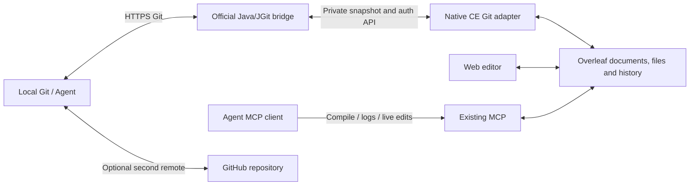

# Direct Git access to Overleaf projects

Status: design proposal, 2026-11-14. The user selected local `git clone / pull / push` as the first Git milestone. No Git endpoint is enabled by this document. Implementation starts in the isolated m701 lab.

## Decision and scope

Expose each enabled Overleaf project as an HTTPS Git remote, using the existing human account and a separate revocable Git token. Reuse the official MIT-licensed Java/JGit bridge and implement its missing CE authentication and snapshot contracts. Keep the current MCP available for targeted live edits, compilation and diagnostics. GitHub App configuration is independent of this milestone.

The [source research](git-integration-reference.md) records the official contracts and citations. The reusable bridge is pinned for evaluation to public commit `e039ad26c5bf5422eb57b89fc7e57c75055e631d`; our CE 6.3.2 runtime has a different revision, `370f4763da4bc910da8309c9a71c85ecbe39f6a7`. Build and compatibility checks are still required.



| First release | Behavior |
| --- | --- |
| Clone, fetch and pull | Export project sources and attachments; subsequent pulls include web/MCP edits. |
| Push | Apply a final project tree containing text edits, additions and deletions, including binary attachments. |
| Branches | One remote branch, `main`, corresponds to the live project. Local feature branches remain ordinary Git branches; merge locally before pushing to `main`. |
| Permissions | Owner enables Git access. Each member creates their own token, limited by their current project role. Read-only members can fetch but cannot push. |
| Files | Editable text up to 2,000,000 bytes; attachments up to 50,000,000 bytes, matching current MCP limits. Git transfers binaries without Base64. |
| User interface | Native project Git dialog and token management, with English labels and existing light/dark themes. |
| Identity | Git commit metadata is retained. Application history/audit records the authenticated human and the token's human/Agent client designation separately. |

The initial scope excludes remote branch creation/deletion, force push, tags, LFS and submodules. Symlinks and unsupported Git file modes are rejected with an actionable error. Renames initially follow delete/add semantics, like official Overleaf; the dialog documents the effect on file comments/tracked changes. Content edits preserve existing native document IDs. A later native-rename optimization requires its own metadata checks.

Existing projects become available on demand. Initial Git history starts from the current project snapshot; existing Overleaf History and project/history IDs remain intact. Importing all historical Overleaf revisions into Git is a separate operation.

## User workflow

Open **Integrations → Git** in the project, choose **Create Git token**, then copy the clone command. Tokens default to this project and can be named, revoked or rotated; show the secret once and store only its digest. The proposed default expiry is 90 days, configurable by administrators. The owner can disable Git access for the project without changing membership.

Proposed command, usable after implementation (replace `PROJECT_ID`):

```sh
git clone --origin overleaf -c credential.useHttpPath=true https://git@latex.clusters.zjusct.io/git/PROJECT_ID paper
cd paper
# Edit files, then select the changes to commit.
git add main.tex
git commit -m "Revise introduction"
git pull --rebase overleaf main
git push overleaf HEAD:main
```

The username is `git`; the password prompt takes the Git token. Use the operating system's Git credential manager. The token is absent from the clone URL and copied command. `credential.useHttpPath=true` keeps credentials for different project URLs separate; `git clone -c` installs this setting before the first fetch. [Git clone configuration](https://git-scm.com/docs/git-clone), [credential matching](https://git-scm.com/docs/gitcredentials).

For a local Agent, issue a named Agent token under the same human account. A separate Agent environment can store its own credential. The ordinary Git client does not require the sidebar Node connector. Compile through the existing project-scoped MCP after a successful push; compile results remain associated with an observed live project version rather than claiming a commit-pinned build.

An optional, initially empty GitHub repository can be added locally:

```sh
git remote add origin git@github.com:ZJUSCT/PROJECT_REPO.git
git push -u origin main
```

The user chooses when to push each remote. A pre-existing GitHub history needs an explicit local reconciliation. Server-side automatic GitHub synchronization and repository installation permissions remain future work.

## Synchronization rules

**Web to Git.** Fetch/pull obtains a coherent native history snapshot and creates a Git commit only when the exported project version has changed. Repeated fetches of unchanged content do not create extra commits. Preserve upstream lazy-commit behavior. Aggregated web commits use the upstream most-recent-editor attribution, with a snapshot/history reference in their message; detailed authorship remains available in Overleaf History. History-label-to-commit support follows the basic round trip.

**Git to web.** A push carries the expected base snapshot and the complete resulting file manifest. Omitted tracked paths are deletions. The adapter stages changed blobs, validates the entire manifest, checks permissions and then rechecks the base version inside a project write barrier. If it has changed, reject with `Project changed. Pull and retry.` The Git client handles merge/rebase conflicts. A binary conflict requires the user or Agent to select the desired file locally.

The official bridge already waits for a web postback before completing its receive hook. Use that contract: `accepted` starts processing; only a persisted, fully applied result produces `upToDate` with the resulting project revision. An HTTP acceptance is not a successful Git push. The public source's per-project lock only coordinates requests inside one bridge process.

### Snapshot and write coordination

Three native facts constrain the implementation:

- `HistoryManager.getLatestZipWithHistoryId` returns a stream with `X-History-Version`; history services also expose versioned content. Prototype a flush-and-pin export through these methods, including immutable attachment references. Enumerating live docs and attachments independently cannot establish one snapshot.
- `sequentialProjectStructureUpdateLock` covers structural operations. Existing MCP `expectedVersion` is checked under a single document's updater lock. Neither alone protects a multi-file Git push from browser edits.
- In the deployed native source, document-updater `RedisManager.blockProject` returns false when documents are already loaded and removes the block. It prevents loading an unloaded project; it does not freeze an active editor. Do not use it as the new write barrier.

The first prototype must establish a short project-wide apply barrier covering native text updates and structural writers, including browser and MCP writes. Drain already accepted work before pinning/rechecking the base. Stage blobs before entering it. Newly arriving edits must receive a retryable response or remain in the editor's acknowledged operation flow; preserve unsent client changes. Verify editor reconnection/OT behavior in the actual CE image before accepting this design for release.

Apply changed text through native document updates, retaining document IDs, and files/tree changes through native entity handlers and history/broadcast paths. Preserve `.gitignore` as a source file. Do not reuse TPDS's Dropbox ignore rules or its project-name-based contract. Do not write document content directly to MongoDB or a compiler working directory.

Native updates across documents are not a database transaction. A durable operation record tracks staged inputs, base revision, target tree, each completed step and the result. If a process stops mid-apply, the project stays write-blocked for reconciliation; the recovering worker completes the recorded operation before releasing the barrier. Do not blindly retry individual writes or restore old content over newer edits. Show `Recovering Git update` in the project UI when recovery is required.

The prototype must resolve crashes after native apply, after postback, and before Git ref persistence. This may require a small persisted operation identifier/status extension in the upstream bridge. Git repository state, bridge version mapping and native project version must reconcile before reporting success. If this coordination is not viable against the pinned CE image, ship only the proven read-only prototype until the write path is ready.

### File fidelity and limits

Compare binary SHA-256 values through clone → push → clone. Validate Chinese text, newlines, BOM and native text-type limitations before writes; reject input that cannot round-trip through the selected native document representation with a specific conversion instruction. Do not silently modify a pushed Git blob while advancing its original commit as the synchronized result.

Validate paths, duplicates, file/folder collisions and unsupported entries before applying anything. An incompatible existing project should receive a precise export error instead of silently omitting files. Measure a representative image-heavy report to set aggregate pack, expanded-tree and repository storage budgets. Align the bridge's defaults (currently 2,000 entries and 52,428,800 bytes per file) with application limits and test the inclusive 50,000,000-byte boundary.

## Module boundaries and persisted state

| Module | Responsibility and interface |
| --- | --- |
| Official Git bridge | HTTPS Git transport, Git objects/refs, lazy commits and snapshot/postback coordination. Build from pinned Java 21/Maven/JGit sources. Keep local changes small and documented. |
| Git credentials | Map a token to user, project, read/write scope, client designation, expiry and revocation. Recheck native project membership on every operation and immediately before apply. |
| Native Git adapter | Implement the bridge's auth and Snapshot API; hide native history, filestore, OT, structure locks and recovery behind snapshot/apply/status operations. |
| Native Git UI | Clone command, token issuance/revocation, last-used information and current sync/recovery result. Reuse existing account and project components. |

Internal adapter contracts recovered from official source:

| Endpoint | Purpose |
| --- | --- |
| `GET /oauth/token/info` | Validate the Bearer Git token forwarded from Git Basic authentication. |
| `GET /api/v0/docs/:projectId` | Authorized latest project version and editor metadata. |
| `GET /api/v0/docs/:projectId/saved_vers` | History label descriptors; the first prototype returns an empty label list and verifies initial version mapping before adding label export. |
| `GET /api/v0/docs/:projectId/snapshots/:version` | Immutable text and attachment snapshot. |
| `POST /api/v0/docs/:projectId/snapshots` | Expected version, complete candidate manifest and trusted bridge callback. |
| Adapter → bridge postback | Durable application outcome and resulting version. |

Exact payloads and source links are in the [reference](git-integration-reference.md). These routes live on a private service interface, reachable from the bridge; the public gateway exposes only `/git/*` and normal authenticated UI routes. Internal service authentication supplements user-token checks. Blob/callback destinations must match configured bridge origins and operation paths. Never fetch arbitrary caller-selected URLs.

Proposed application collections: `git_grants` (hashed credentials and scope), `git_project_links` (enabled status and snapshot mapping), and `git_sync_operations` (durable staged-operation/result records). Bridge repositories and its SQLite bookkeeping live on a dedicated PVC. Stage large blobs on private disk with explicit cleanup after completion/recovery. Back up both bridge state and application metadata with the Overleaf stores; preserving Git commit IDs requires preserving more than the latest project files.

Git commit `author`/`committer` fields remain client-supplied. Trusted audit fields are the authenticated `userId`, `grantId`, project, operation and target commit/tree. Agent tokens set the existing history Agent origin plus a Git source marker through server-controlled metadata. Human Git pushes get an English `via Git` label. No new Overleaf account is created.

## Deployment and development sequence

Use a separate `git-bridge` service with one replica and its own persistent volume. Its in-process locks and local repository bookkeeping require a singleton initially. Application and bridge versions are pinned independently; distribute them together through this repository's Compose configuration and later the organization GitOps chart. Adding the Git service does not require moving project databases or replacing project IDs.

| Step | Concrete deliverable | Minimum useful verification |
| --- | --- | --- |
| 1. Read-only compatibility spike | Self-built official core; CE auth and immutable export; clone URL in the isolated lab. | Clone, unchanged fetch, browser/MCP edit → pull, Chinese text and 50 MB attachment fidelity; inaccessible project and revoked token denial. |
| 2. Recoverable push | Candidate staging, project write barrier, native apply, durable result/postback. | Text/binary create/edit/delete; simultaneous browser edit and two Git clients; stale base rejection; restart around apply/postback/ref update; read-only token denial. |
| 3. Native user experience | Git modal, token management, history labels and useful retry/status messages. | Human/Agent attribution, light/dark UI, actual Git clients and credential persistence on Windows and macOS/Linux. |
| 4. Release preparation | Reproducible images, storage/backup instructions, isolated preview and GitOps patch. | One realistic report round trip and MCP compile; restart/restore with Git commit IDs retained. Present preview before production release. |

Start with step 1, then the write-coordination experiment in step 2. UI expansion follows a working protocol. No general GitHub-provider framework, automatic bidirectional GitHub sync or additional MCP Git wrapper is required for this milestone.

## Evidence and remaining decisions

This design is based on official source inspection and read-only inspection of the current m701 CE runtime. No Maven build, clone/push experiment, new port, deployment or production database change was performed in this design task. The [research note](git-integration-reference.md) separates public-source evidence from runtime assumptions.

The first spike must decide the exact history snapshot pinning path, the editor-compatible write barrier, and restart reconciliation across the native/bridge boundary. Those results determine the minimal CE patches and any bridge patch. The user-facing direction and first-release scope above are settled enough to begin that work.
