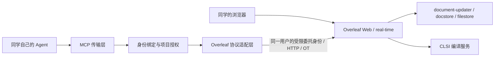

# Overleaf Agent 协作与 MCP 开发计划

调研及决策更新日期：2026-11-05（Asia/Shanghai）。状态：m701 已运行隔离的 CE 6.3.2 实验环境，stdio MCP 的列项目和编译闭环已验证；HTTP 登录授权与实时编辑尚待实现。旧服务保持运行。

## 1. 目标与本轮决策

同学继续在 Overleaf 网页共同编辑，登录后授权各自的 Agent 客户端调用我们维护的 MCP。Agent 使用同一人类用户身份下的独立授权，不创建第二个 Overleaf 用户。网页中的 `张三的 Agent` 是受服务端验证的连接标记；平台记录用户、客户端、授权项目与操作结果。

2026-11-05 决策更新：用户明确选择“已有账号登录后，通过链接连接自己的 Agent”。此决定替代之前每人一个独立 Agent 账号的设计。现有实验账号仅作为开发夹具保留。

建议采用以下默认方案推进：

- 官方 Overleaf CE 作为协议与部署基线，自建独立的 MCP 服务及 Overleaf 适配层。复用 Overleaf 原有协作与项目权限，增加范围明确的授权入口、受限委托身份与 Agent 连接显示扩展；应用补丁随固定上游版本维护。
- 实验基线是 CE 6.3.2，镜像 digest 已固定；实际 TeX Live 和依赖版本记在开发仓库 `docs/progress.md`。源码调查和镜像运行验证分别记录。
- 每位同学仍只有原有 Overleaf 账号；不同客户端对应独立 grant/session，可分别撤销。客户端无法通过工具参数指定或伪造其他用户身份。
- 保留已验证的本地原型作为协议测试工具；下一阶段优先完成 HTTP MCP、登录后的授权连接和撤销，再扩展实时编辑。评论、原生修订审批、SSO 扩展单独评估。
- 旧实例继续提供服务。m701 实验使用独立 Compose 网络、数据库、Redis 和 volumes，入口仅绑定回环地址；后续 K8s 使用独立 namespace、PVC 和域名。
- 源码放独立仓库；本 GitOps 仓库保存部署配置与必要运维记录。技术栈暂定 TypeScript + 官方 MCP SDK，最终在协议实验后确定复用依赖。

## 2. 开源方案与版本依据

| 方案 | 已核实的事实 | 规划用途 |
| --- | --- | --- |
| 官方 Overleaf CE | 开源仓库 AGPL-3.0；官方发布页当前最新条目是 6.3.2（2026-10-23，含安全更新）。具备实时协作与具名用户；评论、实时修订和 Git Bridge 在官方产品划分中属于 Pro。[S1][S2] | 默认基线，可先完成 Agent 直接读写与编译。 |
| 官方 Toolkit | 部署管理工具，不是另一个 Overleaf 版本；当前配置指向 6.3.2，MongoDB 8.0、Redis 7.4，并启用 Redis AOF。[S3] | 作为依赖、配置与启动顺序的来源，转化为本仓库的 K8s 配置。 |
| overleaf-cep（CE+） | 社区 fork，维护者声明增加评论、修订、身份接入、编译沙箱等；当前可见发布标签含 `v6.3.0-ext-v5.1`，需要单独核对安全更新与构建内容。[S4] | 若原生审阅或编译隔离成为上线必需能力，做独立验证；暂不同时承担它与 MCP 的全量定制。 |
| 第三方 MCP | `overleaf-mcp-rt 2.2.0`、`overleaf-web-mcp 0.8.1` 都提供网页会话与 OT 接入参考；前者声明有多版本 CE 测试，后者提供协议文档。[S5][S6] | 用作协议参考、对照测试或经评估后的依赖。选择依据是代码、许可证、测试和维护能力；star 数作为辅助信息。 |

6.x 发布说明要求 MongoDB 8、Redis 7.4；6.2 新增必需的 `OVERLEAF_INVITE_TOKEN_SECRET`。部署前对照目标镜像核实，不沿用旧实例 MongoDB 6 的约束。官方 GitHub releases API 仍含古早 0.x 记录，版本选择应依据官方发布页与 Toolkit。[S1][S3]

## 3. 已理解的接口与调用链

初轮源码调查固定在 main 提交 `e039ad26c5bf5422eb57b89fc7e57c75055e631d`；实际 CE 6.3.2 镜像标注的 revision 是 `370f4763da4bc910da8309c9a71c85ecbe39f6a7`。登录、列项目和编译已在目标镜像验证，实时写入仍需按目标源码核对。以下是应用内部接口，上游升级时需验证兼容性。

| 能力 | 已阅读源码中的入口 | 实现约束 |
| --- | --- | --- |
| 登录、会话 | `GET/POST /login`；登录流程带限流等中间件 | 适配 cookie、CSRF、失效和重登；用户给 MCP 的访问令牌与 Overleaf 会话分别管理。[S7] |
| 项目列表、设置 | `POST /api/project`，`POST /project/:Project_id/settings` | 保留应用权限校验；项目 ID 不能作为授权证明。[S7] |
| 创建文档、目录 | `POST /project/:Project_id/doc`、`.../folder` | 通过应用接口操作文档树；创建、重命名、移动分别映射，避免直接改存储。[S8] |
| 读取与实时编辑 | Socket.IO：加入项目、`joinDoc`、`applyOtUpdate`，以及 `joinProjectResponse` | 维护文档版本、操作队列、ack 和并发转换；区分 ShareJS 与 history-OT 格式，未知格式停止写入。[S9][S10] |
| 在线成员与光标 | `clientTracking.getConnectedUsers`、`clientTracking.updatePosition` | 原生服务端用会话中的用户资料构造姓名和 user_id；同一用户的 Agent 标签需要增加受信任的连接元数据和显示逻辑。[S9][S10][S11] |
| 编辑归属 | `applyOtUpdate` 中服务端写入 `update.meta.user_id` 和 source | 保持人类 user_id；Agent 连接增加受信任的 actor/client/grant 元数据。原生历史仍按用户归属；按 Agent 区分的审计与历史展示需另外实现。[S10] |
| 编译与产物 | `POST /project/:Project_id/compile`、构建结果与 PDF 下载路由 | 返回构建标识、状态、日志和受权限保护的产物；验证编译输入版本与运行中编辑的关系。[S7] |
| 项目成员 | 邀请、接受邀请、移除成员等路由 | 项目所有者授权；MCP 运行工具不暴露成员管理或站点管理员接口。[S12] |
| 实验账号初始化 | CE 的用户创建模块 | 仅用于实验夹具；产品接入复用已登录的人类账号，不再开通独立 Agent 用户。[S13] |

实时服务调用的 private API（例如内部 `/project/:Project_id/join`）有内部认证要求；受限委托接入需要贯穿现有认证与权限链路，内部服务接口保持在服务网络内。

Overleaf 继续负责协同状态与内容持久化；我们的服务保存用户授权、客户端与委托会话引用、请求结果及必要审计信息。普通读写工具不接触 Overleaf 的 MongoDB、Redis 或 PVC。

## 4. 用户登录后的 Agent 授权

### 用户流程

1. 用户正常登录新版 Overleaf，在设置页打开“连接我的 Agent”。
2. 页面提供统一的 HTTPS MCP 地址和受支持客户端的一键导入入口。链接本身不包含长期凭据；不支持导入链接的客户端可粘贴同一 MCP 地址。
3. 客户端发起标准 HTTP MCP 授权，浏览器复用 Overleaf 已登录身份，显示客户端名称、项目范围和读取/编辑/编译权限。
4. 用户确认本次授权后，客户端通过授权码与 PKCE 获得 MCP 访问令牌。用户无需填写 Overleaf 密码或复制浏览器 Cookie。
5. Agent 使用同一人类账号的授权访问项目。网页中用客户端连接元数据区分“张三”与“张三的 Agent”；原生显示层和连接状态需扩展验证。
6. 设置页可列出已连接客户端、授权范围、最后使用时间和撤销入口。撤销后关闭关联实时连接并拒绝后续请求。

所有人的 MCP 服务地址可以相同；区分用户的是完成授权后签发的令牌。链接用于发现/安装服务，不能以“知道链接”作为项目访问凭据。客户端支持情况决定能否一键导入，不承诺所有客户端共享一种安装链接。

### 服务端设计

- 使用成熟 OAuth 授权组件实现 HTTP MCP 的发现、授权码、PKCE、客户端登记与令牌验证；业务扩展负责关联当前 Overleaf 登录身份、项目选择及授权管理。[S14]
- Overleaf 中加入受会话认证和 CSRF 保护的连接/授权入口。身份只能由应用验证后的登录上下文产生，禁止按客户端提交的邮箱认领账号。
- MCP 访问令牌面向 MCP resource；内部另建受限的委托凭据/上下文来访问 Overleaf。用户的日常浏览器 Cookie 不复制给 Agent，也不直接把面向 MCP 的令牌透传为 Overleaf API 凭据。
- 委托上下文包含可信的 user_id、grant_id、client_id、actor_type=agent、项目范围、动作范围和有效期。如何与目标版本的 HTTP/Socket.IO 认证中间件衔接，在 P1 固定；不得直接构造一个拥有全部权限的普通会话作为最终方案。
- 每次 HTTP 操作和实时加入/写入都要求：grant 有效、动作和项目在授权范围内、该用户目前仍拥有对应项目权限。网页管理员身份不自动赋予 MCP 管理能力。
- 长连接不能只在连接时校验一次。撤销或项目权限变化时断开/拒绝后续操作，并覆盖已加入文档的场景。
- 当前 Overleaf 源码按 user_id 归属编辑、按用户资料显示在线姓名；因此同一用户的 Agent 标记需要贯穿实时连接、成员列表及光标显示。历史中用户归属保持不变，Agent 来源先由我们的审计记录呈现，原生历史筛选另行实现。[S10][S11]
- 审计使用服务端认证的用户/客户端信息；Agent 可自报任务描述，但该描述不能充当认证身份。令牌、授权码和浏览器会话不进入模型上下文或日志。
- 现有 stdio 的账号密码配置仅用于隔离实验，不作为同学最终接入方式。HTTP 授权首先验证一种实际客户端，再验证第二种以检查互操作性。

## 5. 功能范围

工具名称是计划中的契约，不是已实现接口。

| 优先级 | 功能 | 拟定接口及行为 |
| --- | --- | --- |
| P0 | 版本与能力诊断 | `capabilities`：Overleaf 版本、文档协议、读写与编译是否可用；兼容性不满足时给出明确原因。 |
| MVP | 身份 | `whoami`：当前用户、客户端/Agent 连接标记、当前授权；不返回凭据。 |
| MVP | 项目浏览 | `list_projects`、`get_project_tree`：只显示获授权的项目和资源。 |
| MVP | 文档上下文 | `read_document`：全篇或分段读取，返回文档 ID、版本、内容摘要；`search_project` 提供有数量和体积限制的文本搜索。 |
| MVP | 局部编辑 | `edit_document`：唯一匹配的旧文本、目标文本、基准版本或摘要、`dry_run`；返回实际 diff、新版本及冲突信息。 |
| MVP | 文件补充 | `create_document`：新增 `.tex`/`.bib` 等文本；限定大小。二进制上传放到后续。 |
| MVP | 协作者变化 | `get_changes`：自指定检查点以来的变化或重新读取要求；检查点过期时返回明确提示。 |
| MVP | 编译闭环 | `compile_project`、`get_compile_result`：构建状态、错误位置、日志、PDF 等；按项目限制并发和频率。 |
| MVP | 访问撤销 | 关闭 MCP 授权、断开 Agent 会话；管理员可暂停指定 Agent。 |
| MVP | 操作记录 | 记录用户、Agent、项目、请求 ID、前后版本和结果；敏感文档内容默认不写普通日志。 |
| 后续 | 项目维护 | 文件上传、重命名、移动，带明确错误与恢复路径。 |
| 后续 | 审阅与恢复 | 修改预览、保存变更记录、按当前版本生成逆向补丁；有人继续编辑后不直接覆盖回旧快照。 |
| 可选 | 原生评论与修订 | 只有选择并验证 CE+/Pro 对应能力后实现；MCP 的 dry-run diff 可先满足修改预览。[S2][S4] |
| 可选 | 客户端身份细分 | 同一用户不同客户端显示不同连接标记；接入界面分别管理授权。 |

首期不开放删除项目、删除账号、修改权限、直接数据库访问、任意 shell 命令。首期专注协作读写和编译，自动写论文、文献检索和选模型由同学的 Agent 工作流负责。

## 6. 编辑与故障语义

- 默认局部补丁；旧文本找不到或多次匹配时返回冲突，不猜测修改位置。
- 每份文档有独立串行提交队列，其他协作者的变更通过 OT 处理；测试中文、emoji 等字符的偏移单位。
- 观察版本变化并匹配当前内容；内容检查与发送之间的竞争由 OT 与服务器版本机制处理。仅在读取时比对一次 hash 不足以保证并发正确。
- 请求携带 operation_id。成功、失败、结果未知分开记录；断线发生在提交之后而 ack 之前时，先恢复状态并核对，避免自动重复应用。
- 多文档修改返回逐文档结果，第一期不提供跨文档原子事务。
- 编译关联 build_id 与已知文档版本；如果有并发编辑，结果标注实际可确定的输入状态，不把旧 PDF 当作最新修改的产物。
- 工具返回冲突、未授权、会话失效、限流、不支持的协议、编译失败等机器可判别错误。

## 7. 分阶段交付

| 阶段 | 主要工作与产出 | 验收信号 |
| --- | --- | --- |
| P0：版本与接口验证 | 锁定 CE 镜像及 revision、依赖、TeX 环境；搭独立实验环境；记录 HTTP/实时事件、会话、CSRF、文档格式；以现有 MCP 做对照；完成代码复用与许可证选择。 | 测试账号可登录、列项目、读一个文档并编译；接口表对应目标镜像。 |
| P1：登录授权与 HTTP 接入 | 两个人类测试用户；添加连接页面、HTTP MCP 与标准授权，复用已有登录；实现受限委托身份、whoami、列表及撤销。 | 不创建 Agent 用户即可连接；两用户不串用；限定项目/动作和撤销有效；无须复制密码/Cookie。 |
| P2：写入和编译闭环 | 适配 OT、会话级 Agent 标记、局部编辑、创建文本、变更读取、编译及日志/PDF；HTTP 和本地调试复用业务实现。 | 人和 Agent 在同一文档编辑，服务端与客户端内容一致；编译产物对应测试修改。 |
| P3：多人试用完善 | 第二种客户端验证、自助授权管理、连接标记、操作记录与配额；补齐项目权限变化与长连接撤销。 | 两名测试用户和两种客户端可用；网页区分同账号的人与 Agent；撤销后活动连接不能继续访问。 |
| P4：K8s 小范围试用 | 独立服务镜像、Argo 配置、存储与会话恢复、Gateway 超时、网络策略、指标与备份；从少量测试项目开始。 | 重启/断线可恢复，构建与编辑错误可定位；验证部署回退；确认编译执行隔离适合预期用户。 |
| P5：可选增强与旧数据迁移 | 根据反馈决定 CE+、原生审阅、多客户端身份；单独演练旧数据恢复、版本升级与用户/项目映射。 | 代表项目、图片、参考文献及必要历史恢复成功；迁移与正式切换方案可审阅。 |

依赖顺序为 P0 → P1 → P2 → P3 → P4；P5 的数据盘点可以提前做，生产迁移在试用后安排。若 P0 发现协议无法可靠适配，先评估一个范围明确的上游补丁或 CE+ 分支，再继续身份和写入开发。

P4 不必先做多副本：可以先单副本并支持重连与恢复。扩容时按账号/项目分配连接所有权，防止多个进程重复提交同一文档操作。

## 8. 最小有效验证集合

使用两个人类测试用户及各自已授权的 Agent 连接、一个共享项目和一个不共享项目、两个文档及一个图片附件。不为 Agent 创建额外 Overleaf 用户。

1. 正常流程：登录 → 读取 → 修改一句话 → 网页可见 → 编译 → 获取 PDF。
2. 并发：人和 Agent 改不同位置；改同一目标文本时得到合并结果或明确冲突，内容不丢失。
3. 断线：提交前断开、提交后 ack 前断开、会话过期；重连后不重复修改。
4. 权限：越权项目 ID、另一用户的授权、撤销后仍有 WebSocket 连接等情况下访问被拒绝。
5. 编译：一个成功样例、一个含已知错误的样例；日志位置和产物版本可解释。
6. 兼容：目标镜像重建后重复基本闭环；后续升级先在测试环境跑相同集合。

首轮只针对以上实际接口行为编写集成测试，不先建设全版本兼容矩阵。

## 9. 数据保留与部署边界

旧实例暂不下线。保留范围包括 MongoDB、Redis、Overleaf 文件及历史存储，以及恢复所需配置。官方说明新镜像可能自动执行数据迁移，且没有通用的两个实例数据合并流程；因此实验阶段不向新版积累需要合并的正式数据，也不让其写旧库。[S15]

后续在约定维护窗口完成一致性备份，在独立副本上恢复并升级。正式迁移时明确选择完整保留账号/历史，或逐项目导入并接受其信息范围；不要将 ZIP 导入当作全量迁移。新数据库升级后的回退按旧版备份恢复设计，不假设换回镜像即可撤销数据库迁移。

CE 编译在应用环境内运行子进程；K8s Pod 本身不提供项目之间的编译隔离。[S16] P0/P2 先用测试项目验证协议，P4 前明确编译进程的文件、网络、资源与 shell-escape 边界。若选择 CE+ 沙箱或单独编译工作节点，将其作为独立部署工作包。

## 来源

- [S1] [官方 6.x 发布说明](https://docs.overleaf.com/on-premises/release-notes/release-notes-6.x.x)
- [S2] [官方角色与权限](https://docs.overleaf.com/on-premises/user-and-project-management/roles-and-permissions)
- [S3] [Toolkit version](https://github.com/overleaf/toolkit/blob/master/lib/config-seed/version)、[overleaf.rc](https://github.com/overleaf/toolkit/blob/master/lib/config-seed/overleaf.rc)
- [S4] [overleaf-cep](https://github.com/yu-i-i/overleaf-cep)、[发布记录](https://github.com/yu-i-i/overleaf-cep/wiki/)
- [S5] [overleaf-mcp-rt](https://github.com/DanielHou315/overleaf-mcp-rt)
- [S6] [overleaf-web-mcp](https://github.com/mhmdaskari/overleaf-web-mcp)、[协议说明](https://mhmdaskari.github.io/overleaf-web-mcp/internals/)
- [S7] [Web router 固定源码](https://github.com/overleaf/overleaf/blob/e039ad26c5bf5422eb57b89fc7e57c75055e631d/services/web/app/src/router.mjs)
- [S8] [EditorRouter 固定源码](https://github.com/overleaf/overleaf/blob/e039ad26c5bf5422eb57b89fc7e57c75055e631d/services/web/app/src/Features/Editor/EditorRouter.mjs)
- [S9] [实时 Router 固定源码](https://github.com/overleaf/overleaf/blob/e039ad26c5bf5422eb57b89fc7e57c75055e631d/services/real-time/app/js/Router.js)
- [S10] [WebsocketController 固定源码](https://github.com/overleaf/overleaf/blob/e039ad26c5bf5422eb57b89fc7e57c75055e631d/services/real-time/app/js/WebsocketController.js)
- [S11] [ConnectedUsersManager 固定源码](https://github.com/overleaf/overleaf/blob/e039ad26c5bf5422eb57b89fc7e57c75055e631d/services/real-time/app/js/ConnectedUsersManager.js)
- [S12] [CollaboratorsRouter 固定源码](https://github.com/overleaf/overleaf/blob/e039ad26c5bf5422eb57b89fc7e57c75055e631d/services/web/app/src/Features/Collaborators/CollaboratorsRouter.mjs)
- [S13] [CE create-user 脚本](https://github.com/overleaf/overleaf/blob/e039ad26c5bf5422eb57b89fc7e57c75055e631d/services/web/modules/server-ce-scripts/scripts/create-user.mjs)
- [S14] [MCP HTTP 授权规范](https://modelcontextprotocol.io/specification/2025-11-25/basic/authorization)
- [S15] [Overleaf 数据与备份](https://docs.overleaf.com/on-premises/maintenance/data-and-backups)
- [S16] [编辑与编译流程](https://github.com/overleaf/overleaf/wiki/Editor-and-Compile-Process)
