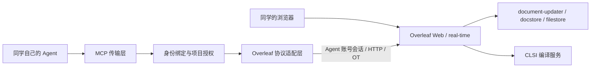

# Overleaf Agent 协作与 MCP 开发计划

调研日期：2026-11-05（Asia/Shanghai）。状态：开发计划与源码调研，尚未部署新版、运行协议兼容测试或修改旧服务。

## 1. 目标与本轮决策

同学继续在 Overleaf 网页共同编辑，使用各自的 Agent 客户端调用我们维护的 MCP。网页中 Agent 以独立账号显示，例如 `张三的 Agent`；平台记录其所属同学、授权项目与操作结果。

建议采用以下默认方案推进：

- 官方 Overleaf CE 作为协议与部署基线，自建独立的 MCP 服务及 Overleaf 适配层。第一期优先复用 Overleaf 原有协作与权限，不改其数据库结构或网页。
- 初始候选是 CE 6.3.2；部署时固定镜像 digest、TeX Live 和依赖版本。源码调查和镜像运行验证分别记录。
- 每位同学一个普通 Agent 账号；同一同学可连接多个客户端，客户端和会话分别记录。按客户端拆分账号留作后续能力。
- 先实现读取、局部编辑、编译、身份与撤销，再做自助绑定和共享 HTTP MCP。评论、原生修订审批、SSO 扩展单独评估。
- 旧实例继续提供服务。新版实验使用独立 namespace、数据库、Redis、PVC 和域名；不连接旧数据库执行迁移。
- 源码放独立仓库；本 GitOps 仓库保存部署配置与必要运维记录。技术栈暂定 TypeScript + 官方 MCP SDK，最终在协议实验后确定复用依赖。

## 2. 开源方案与版本依据

| 方案 | 已核实的事实 | 规划用途 |
| --- | --- | --- |
| 官方 Overleaf CE | 开源仓库 AGPL-3.0；官方发布页当前最新条目是 6.3.2（2026-10-23，含安全更新）。具备实时协作与具名用户；评论、实时修订和 Git Bridge 在官方产品划分中属于 Pro。[S1][S2] | 默认基线，可先完成 Agent 直接读写与编译。 |
| 官方 Toolkit | 部署管理工具，不是另一个 Overleaf 版本；当前配置指向 6.3.2，MongoDB 8.0、Redis 7.4，并启用 Redis AOF。[S3] | 作为依赖、配置与启动顺序的来源，转化为本仓库的 K8s 配置。 |
| overleaf-cep（CE+） | 社区 fork，维护者声明增加评论、修订、身份接入、编译沙箱等；当前可见发布标签含 `v6.3.0-ext-v5.1`，需要单独核对安全更新与构建内容。[S4] | 若原生审阅或编译隔离成为上线必需能力，做独立验证；暂不同时承担它与 MCP 的全量定制。 |
| 第三方 MCP | `overleaf-mcp-rt 2.2.0`、`overleaf-web-mcp 0.8.1` 都提供网页会话与 OT 接入参考；前者声明有多版本 CE 测试，后者提供协议文档。[S5][S6] | 用作协议参考、对照测试或经评估后的依赖。选择依据是代码、许可证、测试和维护能力；star 数作为辅助信息。 |

6.x 发布说明要求 MongoDB 8、Redis 7.4；6.2 新增必需的 `OVERLEAF_INVITE_TOKEN_SECRET`。部署前对照目标镜像核实，不沿用旧实例 MongoDB 6 的约束。官方 GitHub releases API 仍含古早 0.x 记录，版本选择应依据官方发布页与 Toolkit。[S1][S3]

## 3. 已理解的接口与调用链

本轮阅读官方源码固定在 `e039ad26c5bf5422eb57b89fc7e57c75055e631d`。它是调查时 main 的提交，未证明与 CE 6.3.2 镜像内容完全一致；阶段 P0 会提取目标镜像 revision 并复核。以下是应用内部接口，不视为上游承诺稳定的公共 API。

| 能力 | 已阅读源码中的入口 | 实现约束 |
| --- | --- | --- |
| 登录、会话 | `GET/POST /login`；登录流程带限流等中间件 | 适配 cookie、CSRF、失效和重登；用户给 MCP 的访问令牌与 Overleaf 会话分别管理。[S7] |
| 项目列表、设置 | `POST /api/project`，`POST /project/:Project_id/settings` | 保留应用权限校验；项目 ID 不能作为授权证明。[S7] |
| 创建文档、目录 | `POST /project/:Project_id/doc`、`.../folder` | 通过应用接口操作文档树；创建、重命名、移动分别映射，避免直接改存储。[S8] |
| 读取与实时编辑 | Socket.IO：加入项目、`joinDoc`、`applyOtUpdate`，以及 `joinProjectResponse` | 维护文档版本、操作队列、ack 和并发转换；区分 ShareJS 与 history-OT 格式，未知格式停止写入。[S9][S10] |
| 在线成员与光标 | `clientTracking.getConnectedUsers`、`clientTracking.updatePosition` | 服务端用会话中的用户资料构造姓名和 user_id，活动时显示 Agent 身份。[S9][S10][S11] |
| 编辑归属 | `applyOtUpdate` 中服务端写入 `update.meta.user_id` 和 source | 独立账号产生独立编辑身份；不能靠工具参数中的显示名模拟。具体历史 UI 的展示在 P1 验证。[S10] |
| 编译与产物 | `POST /project/:Project_id/compile`、构建结果与 PDF 下载路由 | 返回构建标识、状态、日志和受权限保护的产物；验证编译输入版本与运行中编辑的关系。[S7] |
| 项目成员 | 邀请、接受邀请、移除成员等路由 | 项目所有者授权；MCP 运行工具不暴露成员管理或站点管理员接口。[S12] |
| 创建 Agent 账号 | CE 的 `create-user.mjs` 和管理员创建用户流程 | 初期用管理通道开通，普通 Agent 无站点管理员权限；账号绑定与日常工具调用分离。[S13] |

实时服务调用的 private API（例如内部 `/project/:Project_id/join`）有内部认证要求；适配层沿用正常客户端会话，不将内部服务接口开放给同学。

Overleaf 继续负责协同状态与内容持久化；我们的服务保存绑定、授权、会话引用、请求结果及必要审计信息。普通读写工具不接触 Overleaf 的 MongoDB、Redis 或 PVC。

## 4. 用户身份与授权设计

### 用户流程

1. 管理员开通同学对应的普通 Agent 账号，设置 `张三的 Agent` 等名称；初期人工开通，后续提供管理页面。
2. 项目所有者将这个账号邀请为查看者或编辑者。并非所有项目成员都可以代所有者邀请 Agent。
3. 同学在接入页面验证自己的身份，绑定管理员分配的 Agent；单凭填写邮箱不能完成认领。
4. 同学在支持 MCP 的客户端添加服务地址并授权。客户端仍使用同学自己的模型和模型账户，平台不集中保管其模型密钥。
5. 人和 Agent 在同一项目协作；同学可在接入页面撤销客户端授权，也可由项目所有者移除该 Agent。

### 授权机制

- 可信的登录 subject → 同学 → Agent 的 Overleaf user_id → 允许项目与操作。服务端推导身份，拒绝客户端任意指定另一个 user_id。
- 工具调用要求 MCP 授权、项目允许列表和 Agent 的 Overleaf 项目权限都满足；在共享阶段验证同学与项目的关联，移除其资格时同步撤销绑定授权。
- 项目权限与连接缓存的失效需要实测；撤销后关闭关联 OT 会话，后续请求拒绝。无法确认权限时不继续写入。
- 初期 stdio 原型使用测试账号；小范围 HTTP 试用可发放可撤销、受项目范围约束的个人凭据。正式自助接入采用标准 MCP HTTP 授权，使用成熟 OAuth/OIDC 组件，不自行实现授权协议。[S14]
- 具体身份提供方在 P0 核对；如使用 FreeIPA，需要明确身份桥接路径，不能将 LDAP 服务直接视为 OAuth 授权端。Overleaf CE 内仍可用独立本地 Agent 账号，MCP 登录不要求同时改造 Overleaf SSO。
- 凭据不出现在工具结果、模型上下文或日志；共享服务保管的 Agent 会话应加密存储并支持轮换。模型客户端只获得 MCP 访问令牌。
- 每位同学的多个客户端在第一期共用其 Agent 显示名，以 client_id/session_id 区分操作。第一期不承诺网页能显示模型名称或任务意图。

## 5. 功能范围

工具名称是计划中的契约，不是已实现接口。

| 优先级 | 功能 | 拟定接口及行为 |
| --- | --- | --- |
| P0 | 版本与能力诊断 | `capabilities`：Overleaf 版本、文档协议、读写与编译是否可用；兼容性不满足时给出明确原因。 |
| MVP | 身份 | `whoami`：所属同学、Agent 显示名、当前授权；不返回凭据。 |
| MVP | 项目浏览 | `list_projects`、`get_project_tree`：只显示获授权的项目和资源。 |
| MVP | 文档上下文 | `read_document`：全篇或分段读取，返回文档 ID、版本、内容摘要；`search_project` 提供有数量和体积限制的文本搜索。 |
| MVP | 局部编辑 | `edit_document`：唯一匹配的旧文本、目标文本、基准版本或摘要、`dry_run`；返回实际 diff、新版本及冲突信息。 |
| MVP | 文件补充 | `create_document`：新增 `.tex`/`.bib` 等文本；限定大小。二进制上传放到后续。 |
| MVP | 协作者变化 | `get_changes`：自指定检查点以来的变化或重新读取要求；检查点过期时返回明确提示。 |
| MVP | 编译闭环 | `compile_project`、`get_compile_result`：构建状态、错误位置、日志、PDF 等；按项目限制并发和频率。 |
| MVP | 访问撤销 | 关闭 MCP 授权、断开 Agent 会话；管理员可暂停指定 Agent。 |
| MVP | 操作记录 | 记录用户、Agent、项目、请求 ID、前后版本和结果；敏感文档内容默认不写普通日志。 |
| 后续 | 项目维护 | 文件上传、重命名、移动，带明确错误与恢复路径。 |
| 后续 | 审阅与恢复 | 修改预览、保存变更记录、按当前版本生成逆向补丁；有人继续编辑后不直接覆盖回旧快照。 |
| 可选 | 原生评论与修订 | 只有选择并验证 CE+/Pro 对应能力后实现；MCP 的 dry-run diff 可先满足修改预览。[S2][S4] |
| 可选 | 客户端身份细分 | 同一人不同客户端对应不同 Agent 账号；接入界面管理生命周期。 |

首期不开放删除项目、删除账号、修改权限、直接数据库访问、任意 shell 命令。首期专注协作读写和编译，自动写论文、文献检索和选模型由同学的 Agent 工作流负责。

## 6. 编辑与故障语义

- 默认局部补丁；旧文本找不到或多次匹配时返回冲突，不猜测修改位置。
- 每份文档有独立串行提交队列，其他协作者的变更通过 OT 处理；测试中文、emoji 等字符的偏移单位。
- 观察版本变化并匹配当前内容；内容检查与发送之间的竞争由 OT 与服务器版本机制处理。仅在读取时比对一次 hash 不足以保证并发正确。
- 请求携带 operation_id。成功、失败、结果未知分开记录；断线发生在提交之后而 ack 之前时，先恢复状态并核对，避免自动重复应用。
- 多文档修改返回逐文档结果，第一期不提供跨文档原子事务。
- 编译关联 build_id 与已知文档版本；如果有并发编辑，结果标注实际可确定的输入状态，不把旧 PDF 当作最新修改的产物。
- 工具返回冲突、未授权、会话失效、限流、不支持的协议、编译失败等机器可判别错误。

## 7. 分阶段交付

| 阶段 | 主要工作与产出 | 验收信号 |
| --- | --- | --- |
| P0：版本与接口验证 | 锁定 CE 镜像及 revision、依赖、TeX 环境；搭独立实验环境；记录 HTTP/实时事件、会话、CSRF、文档格式；以现有 MCP 做对照；完成代码复用与许可证选择。 | 测试账号可登录、列项目、读一个文档并编译；接口表对应目标镜像。 |
| P1：独立身份与读操作 | 两位同学各自的人类/Agent 账号；验证绑定、邀请、姓名显示、光标与编辑归属；实现 whoami、列表、目录和读取。 | 网页正确识别两个 Agent；无权限项目不可访问；记录历史归属具体可见位置。 |
| P2：写入和编译闭环 | 适配 OT，局部编辑、创建文本、变更读取、编译、日志/PDF；先用 stdio 跑通，再让传输层复用同一业务实现。 | 人和 Agent 在同一文档编辑，服务端与客户端内容一致；编译产物对应测试修改。 |
| P3：同学自助接入 | Streamable HTTP、身份提供方和标准授权、客户端绑定及撤销、凭据隔离、操作记录与配额。 | 至少两名测试用户、两种实际 MCP 客户端接入；身份不串用；撤销后后续请求和活动会话均失去访问。 |
| P4：K8s 小范围试用 | 独立服务镜像、Argo 配置、存储与会话恢复、Gateway 超时、网络策略、指标与备份；从少量测试项目开始。 | 重启/断线可恢复，构建与编辑错误可定位；验证部署回退；确认编译执行隔离适合预期用户。 |
| P5：可选增强与旧数据迁移 | 根据反馈决定 CE+、原生审阅、多客户端身份；单独演练旧数据恢复、版本升级与用户/项目映射。 | 代表项目、图片、参考文献及必要历史恢复成功；迁移与正式切换方案可审阅。 |

依赖顺序为 P0 → P1 → P2 → P3 → P4；P5 的数据盘点可以提前做，生产迁移在试用后安排。若 P0 发现协议无法可靠适配，先评估一个范围明确的上游补丁或 CE+ 分支，再继续身份和写入开发。

P4 不必先做多副本：可以先单副本并支持重连与恢复。扩容时按账号/项目分配连接所有权，防止多个进程重复提交同一文档操作。

## 8. 最小有效验证集合

使用两个测试用户及各自 Agent、一个共享项目和一个不共享项目、两个文档及一个图片附件。

1. 正常流程：登录 → 读取 → 修改一句话 → 网页可见 → 编译 → 获取 PDF。
2. 并发：人和 Agent 改不同位置；改同一目标文本时得到合并结果或明确冲突，内容不丢失。
3. 断线：提交前断开、提交后 ack 前断开、会话过期；重连后不重复修改。
4. 权限：越权项目 ID、另一用户绑定、撤销后仍有 WebSocket 连接等情况下访问被拒绝。
5. 编译：一个成功样例、一个含已知错误的样例；日志位置和产物版本可解释。
6. 兼容：目标镜像重建后重复基本闭环；后续升级先在测试环境跑相同集合。

首轮只针对以上实际接口行为编写集成测试，不先建设全版本兼容矩阵。

## 9. 数据保留与部署边界

旧实例暂不下线。保留范围包括 MongoDB、Redis、Overleaf 文件及历史存储，以及恢复所需配置。官方说明新镜像可能自动执行数据迁移，且没有通用的两个实例数据合并流程；因此实验阶段不向新版积累需要合并的正式数据，也不让其写旧库。[S15]

后续在约定维护窗口完成一致性备份，在独立副本上恢复并升级。正式迁移时明确选择完整保留账号/历史，或逐项目导入并接受其信息范围；不要将 ZIP 导入当作全量迁移。新数据库升级后的回退按旧版备份恢复设计，不假设换回镜像即可撤销数据库迁移。

CE 编译在应用环境内运行子进程；K8s Pod 本身不提供项目之间的编译隔离。[S16] P0/P2 先用测试项目验证协议，P4 前明确编译进程的文件、网络、资源与 shell-escape 边界。若选择 CE+ 沙箱或单独编译工作节点，将其作为独立部署工作包。

## 来源

- [S1] [官方 6.x 发布说明](https://docs.overleaf.com/on-premises/release-notes/release-notes-6.x.x)
- [S2] [官方角色与权限](https://docs.overleaf.com/on-premises/user-and-project-management/roles-and-permissions)
- [S3] [Toolkit version](https://github.com/overleaf/toolkit/blob/master/lib/config-seed/version)、[overleaf.rc](https://github.com/overleaf/toolkit/blob/master/lib/config-seed/overleaf.rc)
- [S4] [overleaf-cep](https://github.com/yu-i-i/overleaf-cep)、[发布记录](https://github.com/yu-i-i/overleaf-cep/wiki/)
- [S5] [overleaf-mcp-rt](https://github.com/DanielHou315/overleaf-mcp-rt)
- [S6] [overleaf-web-mcp](https://github.com/mhmdaskari/overleaf-web-mcp)、[协议说明](https://mhmdaskari.github.io/overleaf-web-mcp/internals/)
- [S7] [Web router 固定源码](https://github.com/overleaf/overleaf/blob/e039ad26c5bf5422eb57b89fc7e57c75055e631d/services/web/app/src/router.mjs)
- [S8] [EditorRouter 固定源码](https://github.com/overleaf/overleaf/blob/e039ad26c5bf5422eb57b89fc7e57c75055e631d/services/web/app/src/Features/Editor/EditorRouter.mjs)
- [S9] [实时 Router 固定源码](https://github.com/overleaf/overleaf/blob/e039ad26c5bf5422eb57b89fc7e57c75055e631d/services/real-time/app/js/Router.js)
- [S10] [WebsocketController 固定源码](https://github.com/overleaf/overleaf/blob/e039ad26c5bf5422eb57b89fc7e57c75055e631d/services/real-time/app/js/WebsocketController.js)
- [S11] [ConnectedUsersManager 固定源码](https://github.com/overleaf/overleaf/blob/e039ad26c5bf5422eb57b89fc7e57c75055e631d/services/real-time/app/js/ConnectedUsersManager.js)
- [S12] [CollaboratorsRouter 固定源码](https://github.com/overleaf/overleaf/blob/e039ad26c5bf5422eb57b89fc7e57c75055e631d/services/web/app/src/Features/Collaborators/CollaboratorsRouter.mjs)
- [S13] [CE create-user 脚本](https://github.com/overleaf/overleaf/blob/e039ad26c5bf5422eb57b89fc7e57c75055e631d/services/web/modules/server-ce-scripts/scripts/create-user.mjs)
- [S14] [MCP HTTP 授权规范](https://modelcontextprotocol.io/specification/2025-11-25/basic/authorization)
- [S15] [Overleaf 数据与备份](https://docs.overleaf.com/on-premises/maintenance/data-and-backups)
- [S16] [编辑与编译流程](https://github.com/overleaf/overleaf/wiki/Editor-and-Compile-Process)
