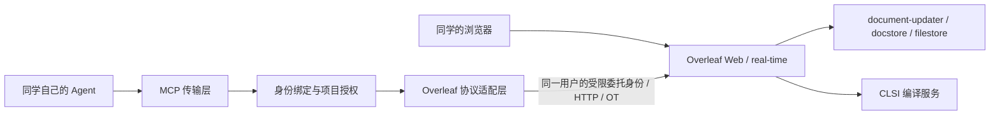

# Overleaf Agent 协作与 MCP 开发计划

决策更新日期：2026-11-14（Asia/Shanghai）。新版 Overleaf 与扩展 MCP 已部署，当前状态以 [progress](progress.md) 为准；下文保留各阶段决策。当前新增优先项为项目直接 Git 访问，已完成源码调研与设计，尚未实现。服务端 DeepSeek Harness 仍处于调研阶段。

## 1. 目标与本轮决策

2026-11-14 Git 管理决策：用户选择本地直接 `git clone / pull / push` Overleaf 项目。优先复用官方公开的 MIT Java/JGit Git Bridge，在当前 CE 上补齐个人 Git token、Snapshot API、项目版本检查及可恢复的多文件写入；首版单分支 `main`，保留原账号和实时协作。GitHub 可作为本地第二个 remote，不依赖 GitHub App。现有 MCP 继续提供实时工具、编译和日志。先在 m701 独立环境验证 clone/pull，再验证浏览器并发编辑下的 push 与中断恢复，最后完成原生 Git 弹窗并提供预览。完整范围与阶段见 [Git remote design](git-remote-design.md)，官方接口与复用依据见 [Git integration reference](git-integration-reference.md)。本次仅设计，未修改生产。

2026-11-14 MCP 文件接口：个人 HTTP MCP 增加 `overleaf_create_file` 和 `overleaf_delete_file`，沿用当前用户身份、grant 的 edit 范围与实时项目权限。新建支持 UTF-8 可编辑文档（最大 2 MB）和 Base64 附件（最大 50 MB，包含 JPG/PNG/SVG/PDF），HTTP 请求上限为 72 MiB，不覆盖同名实体；删除按文件 ID + 当前绝对路径操作单个文档或附件。目录列表及父目录 ID 纳入项目树返回。复用原生结构锁、历史及广播，写入记录 operationId 并拒绝自动重放；暂不新增目录管理、移动或重命名工具。验证在 m701 隔离 Compose 中进行，生产部署单独推进。

2026-11-14 GitHub 关联决策：采用组织维护的 GitHub App。现有用户先用邮箱登录，再在 Account Settings 授权并确认 GitHub 身份；保留现有账号 ID、邮箱、密码、项目与 MCP 授权。首阶段仅做绑定、重复绑定检测和解绑，不进行自动邮箱合并、开放注册或替换登录方式。仓库安装授权及同步后续独立实现；当前不申请仓库权限、不持久化 GitHub token。应用尚未创建，先完成代码与隔离预览，配置及上线步骤见 [GitHub App setup](github-app-setup.md)。

2026-11-12 用户选择 [DeepSeek Harness](https://github.com/deepseek-ai/deepseek-harness) 作为网页助手的服务端运行时，替代要求普通用户安装并常驻本地 Node 连接器的默认流程。保留 Overleaf 原生侧栏，登录后由服务端建立个人项目会话；个人 MCP 链接继续供外部 Agent 使用。此前“队内公用 token 托管方案不实施”的决定属于 11 月 6 日阶段，本轮重新推进托管方向，模型 endpoint、model 与凭据在服务端配置。

接口核验（2026-11-12，官方仓库文档）：DSH 的 [`acp` profile](https://github.com/deepseek-ai/deepseek-harness/blob/master/packages/acp/acp/README.md) 提供 stdio ACP v1、HTTP MCP 挂载、独立 session、持久化 resume、取消和权限请求；与现有 `AcpRuntime` 的主要能力相符。ACP 为受信任程序控制接口，认证方法直接成功，因此仅由内部 worker 调用，网页登录、用户与项目鉴权继续由 Overleaf 承担。它输出标准语义更新，侧栏回复呈现粒度需用真实运行时验证。官方标记为 developer preview，部署固定验证过的版本和依赖；调研时源码根 package 为 `0.2.2-rc.2`、Node 要求 `>=24.9.0`，尚未选定部署版本。

拟实施的托管路径：

1. 在 m701 独立试验环境验证 DSH ACP 初始化、当前项目 HTTP MCP、读取→修改→编译→日志闭环，以及停止和进程重启后的会话恢复。先用测试项目，不修改旧生产数据。
2. 增加服务端 worker 管理，按用户隔离运行目录及 DSH 持久化目录，首版使用独立容器；会话绑定 `userId + projectId + conversationId`。worker 仅持有该用户当前项目的 MCP 授权，不挂载 Overleaf 数据库或项目存储卷。模型凭据保存在服务端，调用额度和并发按用户记录。
3. 复用现有聊天消息、历史、取消与权限检查，改为自动建立托管连接。侧栏默认显示对话与任务状态，移除默认流程中的运行时选择、下载连接器和手动配对步骤。
4. 新增待确认修改及差异预览：用户接受后再次检查文档版本并提交，随后编译和显示诊断。现有 MCP 直接写入工具仍用于外部 Agent；托管模式通过服务端工具策略控制写入，不能只靠提示词要求确认。

以上为待开发方案；已核验 DSH 官方接口，尚未安装、部署或进行真实模型调用测试。首轮通过后再确定托管版交付范围。

同学继续在 Overleaf 网页共同编辑，登录后生成属于自己的 MCP URL，复制到 Agent 客户端即可连接。URL 携带随机访问密钥，由服务端映射到该用户及授权范围，无须客户端再进行浏览器授权。Agent 使用同一人类用户身份下的独立授权，不创建第二个 Overleaf 用户。网页中的 `张三的 Agent` 是受服务端验证的连接标记；平台记录用户、客户端、授权项目与操作结果。

2026-11-05 用户澄清：每个用户生成专属的、可直接连接的 MCP URL。此决定替代此前对“链接”的 OAuth 导入入口解释，同时保留同一人类账号下的委托访问模型。现有独立 Agent 实验账号仅作为开发夹具保留。

2026-11-06 用户批准侧栏聊天：连接管理改为原生主题弹窗；轻量连接器在用户自己的设备启动 ACP Agent，模型账号留在本地。实现使用 SSE 下发命令、HTTP 回传事件，复用现有站点入口；浏览器使用会话认证和 CSRF，文档操作继续走 MCP。会话按用户与项目持久化；断线不重放正在执行的任务，重连后恢复可见会话上下文。首版协议适配为 ACP v1，其他非 ACP CLI 需要独立适配。

2026-11-06 后续决定：侧栏继续连接同学自己的 Agent，适配 Codex、Claude Code，并保留 OpenCode；队内公用 token 托管方案不实施。连接器使用固定版本的 ACP 适配器，复用本机登录及模型配置。连接建立后为当前项目预建会话，HTTP MCP URL 仅放工具配置；应用指令写入 session 的追加 system prompt。后续用户消息直接发到同一 session，附加文件/选区单独随消息传入。重连恢复可见会话上下文，不重放任务；新对话使用新 session。

2026-11-06 编译反馈优化：用户反馈 Agent 只得到 `failure` 后要求手工粘贴日志。本轮补齐编译响应中的错误位置/摘要、警告、编译器与根文档信息，并增加按用户、项目、buildId 读取日志的工具。复用固定 Overleaf 版本的原生日志解析器；工具指令与侧栏应用指令指导 Agent 读取当前文档、局部修复、最多三轮重编译。日志失败保留编译状态并给出原因；设置变更与 PDF 下载仍单独实施。

2026-11-06 连接状态修复：针对“本地 Node 已连接、网页仍离线”，网页自动选择可用连接并保留未发送草稿和明确选择的历史；配对完成按 pairingId 选中新连接；初次加载失败由后续轮询恢复。终端列出授权项目，网页提示已在线但属于其他项目的连接，保持原项目授权范围。连接建立与项目会话就绪分别显示。

2026-11-06 会话交互完善（开发分支，暂不上线）：用户要求分清连接与对话，提供历史、搜索、重命名、归档/恢复与明确的 Agent 切换。新对话先保留本页草稿，首条消息才持久化；在线连接变化不跳走当前对话。相同对话可切换到本人授权当前项目的在线连接，保留记录并显式提示上下文重建；运行中禁止切换，迟到的初始化回报按绑定版本拒绝。原生 Agent session 的跨重启恢复留作下一阶段，本轮不改生产入口和原实验实例。

2026-11-06 原生会话恢复（开发分支，暂不上线）：连接器在配置文件旁保存网页对话与 ACP 原生会话的索引，以站点、连接、项目、绑定版本、运行时与 MCP 配置指纹隔离。优先协商 `session/resume`，其次 `session/load`；加载回放不写入网页消息。缺失会话或不支持恢复时使用有限可见历史重建，登录/网络/运行时异常保留索引并提示重试；中断任务不自动重发。服务端仅接收恢复状态，原生 session ID 留在本机。协议依据：[ACP v1 Session Setup](https://agentclientprotocol.com/protocol/v1/session-setup)，并核对固定 Codex ACP 2.5.0 / Claude ACP 0.101.0 源码。

2026-11-06 侧栏阅读与输入完善（开发分支，暂不上线）：Agent 回复支持 Markdown 和代码复制，工具详情保留用户展开选择；阅读历史时停止自动跟随，提供返回最新输出入口。发送快捷键与按钮共用就绪条件，中文输入法确认不触发发送；保留请求等待期间输入的下一条草稿。沿用固定镜像已有解析库与原生 UI 组件。

建议采用以下默认方案推进：

- 官方 Overleaf CE 作为协议与部署基线，MCP 以独立 TypeScript 模块开发；首版打包进 Overleaf Web 扩展，直接复用登录身份与应用权限。复用 Overleaf 原有协作与项目权限，增加范围明确的授权入口、受限委托身份与 Agent 连接显示扩展；应用补丁随固定上游版本维护。
- 实验基线是 CE 6.3.2，镜像 digest 已固定；实际 TeX Live 和依赖版本记在开发仓库 `docs/progress.md`。源码调查和镜像运行验证分别记录。
- 每位同学仍只有原有 Overleaf 账号；每条专属链接对应独立 grant，可重置或撤销，也可按客户端增发链接。客户端无法通过工具参数指定或伪造其他用户身份。
- 保留 stdio 原型作为协议测试工具；个人 HTTP URL、撤销、文档读取与局部编辑已实现，下一阶段完善原生连接标签和实际客户端接入。评论、原生修订审批、SSO 扩展单独评估。
- 旧实例继续提供服务。m701 实验使用独立 Compose 网络、数据库、Redis 和 volumes，入口仅绑定回环地址；后续 K8s 使用独立 namespace、PVC 和域名。
- 源码放独立仓库；本 GitOps 仓库保存部署配置与必要运维记录。技术栈暂定 TypeScript + 官方 MCP SDK，最终在协议实验后确定复用依赖。

## 2. 开源方案与版本依据

| 方案 | 已核实的事实 | 规划用途 |
| --- | --- | --- |
| 官方 Overleaf CE | 开源仓库 AGPL-3.0；官方发布页当前最新条目是 6.3.2（2026-10-23，含安全更新）。具备实时协作与具名用户；评论、实时修订和 Git Bridge 在官方产品划分中属于 Pro。[S1][S2] | 默认基线，可先完成 Agent 直接读写与编译。 |
| 官方 Toolkit | 部署管理工具，不是另一个 Overleaf 版本；当前配置指向 6.3.2，MongoDB 8.0、Redis 7.4，并启用 Redis AOF。[S3] | 作为依赖、配置与启动顺序的来源，转化为本仓库的 K8s 配置。 |
| overleaf-cep（CE+） | 社区 fork，维护者声明增加评论、修订、身份接入、编译沙箱等；当前可见发布标签含 `v6.3.0-ext-v5.1`，需要单独核对安全更新与构建内容。[S4] | 若原生审阅或编译隔离成为上线必需能力，做独立验证；暂不同时承担它与 MCP 的全量定制。 |
| 第三方 MCP | `overleaf-mcp-rt 2.2.0`、`overleaf-web-mcp 0.8.1` 都提供网页会话与 OT 接入参考；前者声明有多版本 CE 测试，后者提供协议文档。[S5][S6] | 用作协议参考、对照测试或经评估后的依赖。选择依据是代码、许可证、测试和维护能力；star 数作为辅助信息。 |

6.x 发布说明要求 MongoDB 8、Redis 7.4；6.2 新增必需的 `OVERLEAF_INVITE_TOKEN_SECRET`。部署前对照目标镜像核实，不沿用旧实例 MongoDB 6 的约束。官方 GitHub releases API 仍含古早 0.x 记录，版本选择应依据官方发布页与 Toolkit。[S1][S3]

## 3. 已理解的接口与调用链

初轮源码调查固定在 main 提交 `e039ad26c5bf5422eb57b89fc7e57c75055e631d`；实际 CE 6.3.2 镜像标注的 revision 是 `370f4763da4bc910da8309c9a71c85ecbe39f6a7`。登录、列项目、个人 HTTP MCP 和编译已在目标镜像验证；首版写入复用 document-updater 在文档锁内生成 OT 并广播，额外校验 expectedVersion。以下是应用内部接口，上游升级时需验证兼容性。

| 能力 | 已阅读源码中的入口 | 实现约束 |
| --- | --- | --- |
| 登录、会话 | `GET/POST /login`；登录流程带限流等中间件 | 适配 cookie、CSRF、失效和重登；用户给 MCP 的访问令牌与 Overleaf 会话分别管理。[S7] |
| 项目列表、设置 | `POST /api/project`，`POST /project/:Project_id/settings` | 保留应用权限校验；项目 ID 不能作为授权证明。[S7] |
| 创建文档、目录 | `POST /project/:Project_id/doc`、`.../folder` | 通过应用接口操作文档树；创建、重命名、移动分别映射，避免直接改存储。[S8] |
| 读取与实时编辑 | Socket.IO：加入项目、`joinDoc`、`applyOtUpdate`，以及 `joinProjectResponse` | 维护文档版本、操作队列、ack 和并发转换；区分 ShareJS 与 history-OT 格式，未知格式停止写入。[S9][S10] |
| 在线成员与光标 | `clientTracking.getConnectedUsers`、`clientTracking.updatePosition` | 原生服务端用会话中的用户资料构造姓名和 user_id；同一用户的 Agent 标签需要增加受信任的连接元数据和显示逻辑。[S9][S10][S11] |
| 编辑归属 | `applyOtUpdate` 中服务端写入 `update.meta.user_id` 和 source | 保持人类 user_id；Agent 连接增加受信任的 actor/client/grant 元数据。原生历史仍按用户归属；按 Agent 区分的审计与历史展示需另外实现。[S10] |
| 编译与产物 | `POST /project/:Project_id/compile`、构建结果与 PDF 下载路由 | 返回构建标识、状态、日志和受权限保护的产物；验证编译输入版本与运行中编辑的关系。[S7] |
| 项目成员 | 邀请、接受邀请、移除成员等路由 | 项目所有者授权；MCP 运行工具不暴露成员管理或站点管理员接口。[S12] |
| 实验账号初始化 | CE 的用户创建模块 | 仅用于实验夹具；产品接入复用已登录的人类账号，不再开通独立 Agent 用户。[S13] |

实时服务调用的 private API（例如内部 `/project/:Project_id/join`）有内部认证要求；受限委托接入需要贯穿现有认证与权限链路，内部服务接口保持在服务网络内。

Overleaf 继续负责协同状态与内容持久化；我们的服务保存用户授权、客户端与委托会话引用、请求结果及必要审计信息。普通读写工具不接触 Overleaf 的 MongoDB、Redis 或 PVC。

## 4. 用户登录后的 Agent 授权

### 用户流程

1. 用户正常登录新版 Overleaf，在设置页点击“生成我的 MCP 链接”。
2. 服务端生成绑定当前用户的专属 URL，例如 `https://mcp.example.com/mcp/p/<key-id>.<random-secret>`（示意地址）。创建页可选择全部本人可访问项目或指定项目，以及读取/编辑/编译权限。
3. 用户把完整 URL 填入 Agent 客户端的 HTTP MCP 地址栏，即可连接。无额外 OAuth 跳转，也不需要提供 Overleaf 密码或 Cookie。
4. MCP 从密钥查到用户和授权，以该用户身份操作项目；编辑归属原用户，在线连接可以显示“张三的 Agent”。
5. 设置页显示链接名称、授权范围、创建及最后使用时间，并提供撤销和重新生成。完整密钥只在生成时显示；之后通过重新生成获得新链接，原链接立即失效。

首期每位用户可先生成一条个人链接；数据结构支持按客户端增发，便于分别命名与撤销。同一链接可以重连并维持多个会话；浏览器登出不自动使它失效。链接默认持续有效直至撤销，也可设置过期时间。分享完整 URL 即授予其持有人相应权限，因此将它存放在客户端个人配置中。

### 当前实现决策

2026-11-05：首版将 MCP SDK 打包为 Overleaf Web 模块，管理页复用原登录和 CSRF；Nginx 把密钥路径改写成固定内部路径后转发，模块在读取密钥后移除对应头部。授权和编辑操作记录分别存入 `agent_grants`、`agent_operations`。

编辑通过应用模块检查项目/文档归属，再调用原生 document-updater；其 `setDocWithLock` 内新增可选 expectedVersion 比较，比较成功后使用原生差分、OT、历史和广播逻辑。补丁固定源码哈希，读取接口返回能力标记，未知文档类型拒绝写入。MCP 使用无状态 HTTP 请求，因此撤销无需维护 MCP 长连接；未来添加在线 Agent 光标时再覆盖该长连接生命周期。

管理页已改为 Overleaf 原生 `layout-react` 页面，复用账号设置页的导航、卡片、表单和按钮组件。编辑器通过 `railEntries` 扩展加入“我的 Agent”侧栏，入口以新标签页打开管理页并默认限定当前项目；不可访问的项目上下文阻止生成链接。前端使用固定上游镜像内的源码与 Yarn 缓存重建，共享 runtime 与 manifest 一同生成。

History 使用原生保存的 `origin.kind=agent` 区分 MCP 编辑。在历史响应中，将作者投影为 `id=agent:<userId>`、`userId=<原用户 ID>`、`actorType=agent`，本人看到 `Your agent`，其他查看者看到 `<姓名>'s agent`；此 ID 只用于历史作者展示与颜色。数据库中的作者、权限与登录身份不变，不建立第二个账号。差异预览保留手动编辑与 Agent 编辑的来源边界；已有 Agent 来源的历史直接适用。首版按用户区分 Agent，尚不按链接名称细分客户端。

已验证 ShareJS 中文编辑和网页实时更新。原生 ShareJS 会替换 UTF-16 surrogate，当前主动拒绝含 emoji 等非 BMP 字符的写入。history-OT 使用原生更新路径，尚未完成单独的实际项目验证。编译返回已观察的根文档版本、可获得的历史版本和 snapshotPinned=false，明确并发编辑时没有固定整个项目快照。

### 协议与客户端

传输使用 Streamable HTTP；在入口验证 URL 密钥后交给 MCP SDK。MCP 请求和响应、初始化、工具调用保持标准格式。[S17] 这是自定义个人密钥认证：MCP 的标准 HTTP 授权方案采用 OAuth 和 Authorization 请求头，并禁止将 OAuth access token 放在查询参数中。[S14] 本方案不把密钥 URL 宣称为该 OAuth 流程，也不将路径中的密钥理解为已验证的客户端身份。

首期验证一个允许手工填写完整 HTTP MCP URL 的实际客户端，再验证第二种。VS Code 的官方文档提供手工输入 MCP endpoint 的入口，可作为候选；尚未对本服务完成客户端实测。[S18] 某些托管客户端可能要求 OAuth，可后续增加共享地址加标准授权入口，个人 URL 仍保留。

### 服务端设计

- Overleaf 中加入受会话认证和 CSRF 保护的密钥生成、列表、撤销与重置接口。用户身份只取自已验证的登录上下文。
- 使用密码学安全随机源生成至少 32 字节的 secret，编码为 URL-safe 字符；key-id 用于查找记录，不能单独授权。数据库保存 secret 摘要、user_id、grant_id、用户指定名称、项目/动作范围、有效期和撤销状态。
- 每个 HTTP 请求先验证完整密钥、grant 状态与用户状态，覆盖 POST、GET 和 DELETE。MCP session 绑定 grant/user；持有 session-id 不能绕过密钥认证或跨用户使用会话。工具参数不能改变身份。
- 全部外部请求使用 HTTPS；避免重定向。网关、应用、错误报告和 tracing 在记录前移除完整密钥路径，以 grant_id 记录请求；检查测试密钥不会出现在这些日志中。生成页面设置 `Cache-Control: no-store` 和 `Referrer-Policy: no-referrer`，不加载第三方追踪资源。将密钥放在路径中同样需要这些保护。
- MCP 内部建立限定范围的 Overleaf 委托上下文，包含 user_id、grant_id、actor_type=agent、项目范围、动作范围和有效期。个人 URL 密钥留在 MCP 边界，用户的日常浏览器 Cookie 不交给 Agent。首版扩展直接调用应用授权与文档服务，不生成普通用户 Cookie；文档写入前再次校验链接状态和项目权限。
- 每次 HTTP 操作和实时加入/写入同时验证 grant、动作范围、项目范围和该用户当前的 Overleaf 项目权限。选择“全部项目”时随当前权限变化，权限移除后立即失去访问。MCP 不暴露站点管理接口。
- 撤销或重置后拒绝新请求，关闭关联实时连接；活动文档的后续操作也重新校验权限。已经提交的编辑不因撤销而回滚。
- 原生编辑继续归属于同一 user_id；“张三的 Agent”由服务端认证的 grant/连接标记产生。在线列表和光标需要 Overleaf 服务端与界面扩展，原生历史按用户归属。[S10][S11]
- 同一密钥被多个客户端使用时，能够区分会话，但不能验证客户端自报名称。需要独立撤销或可信命名时，由用户创建不同的命名链接。审计记录用户、grant、session 和操作结果。
- 当前 stdio 账号密码配置仅用于隔离实验；产品接入以个人密钥 URL 为首期方式。

## 5. 功能范围

工具名称是计划中的契约，不是已实现接口。

| 优先级 | 功能 | 拟定接口及行为 |
| --- | --- | --- |
| P0 | 版本与能力诊断 | `capabilities`：Overleaf 版本、文档协议、读写与编译是否可用；兼容性不满足时给出明确原因。 |
| MVP | 身份 | `whoami`：当前用户、客户端/Agent 连接标记、当前授权；不返回凭据。 |
| MVP | 项目浏览 | `list_projects`、`get_project_tree`：只显示获授权的项目和资源。 |
| MVP | 文档上下文 | `read_document`：全篇或分段读取，返回文档 ID、版本、内容摘要；`search_project` 提供有数量和体积限制的文本搜索。 |
| MVP | 局部编辑 | `edit_document`：唯一匹配的旧文本、目标文本、基准版本或摘要、`dry_run`；返回实际 diff、新版本及冲突信息。 |
| MVP | 文件补充 | `create_document`：新增 `.tex`/`.bib` 等文本；限定大小。二进制上传放到后续。 |
| MVP | 协作者变化 | `get_changes`：自指定检查点以来的变化或重新读取要求；检查点过期时返回明确提示。 |
| MVP | 编译闭环 | `compile_project`、`get_compile_result`：构建状态、错误位置、日志、PDF 等；按项目限制并发和频率。 |
| MVP | 访问撤销 | 关闭 MCP 授权、断开 Agent 会话；管理员可暂停指定 Agent。 |
| MVP | 操作记录 | 记录用户、Agent、项目、请求 ID、前后版本和结果；敏感文档内容默认不写普通日志。 |
| 后续 | 项目维护 | 文件上传、重命名、移动，带明确错误与恢复路径。 |
| 后续 | 审阅与恢复 | 修改预览、保存变更记录、按当前版本生成逆向补丁；有人继续编辑后不直接覆盖回旧快照。 |
| 可选 | 原生评论与修订 | 只有选择并验证 CE+/Pro 对应能力后实现；MCP 的 dry-run diff 可先满足修改预览。[S2][S4] |
| 可选 | 客户端身份细分 | 同一用户不同客户端显示不同连接标记；接入界面分别管理授权。 |

首期不开放删除项目、删除账号、修改权限、直接数据库访问、任意 shell 命令。首期专注协作读写和编译，自动写论文、文献检索和选模型由同学的 Agent 工作流负责。

## 6. 编辑与故障语义

- 默认局部补丁；旧文本找不到或多次匹配时返回冲突，不猜测修改位置。
- 每份文档有独立串行提交队列，其他协作者的变更通过 OT 处理；测试中文、emoji 等字符的偏移单位。
- 观察版本变化并匹配当前内容；内容检查与发送之间的竞争由 OT 与服务器版本机制处理。仅在读取时比对一次 hash 不足以保证并发正确。
- 请求携带 operation_id。成功、失败、结果未知分开记录；断线发生在提交之后而 ack 之前时，先恢复状态并核对，避免自动重复应用。
- 多文档修改返回逐文档结果，第一期不提供跨文档原子事务。
- 编译关联 build_id 与已知文档版本；如果有并发编辑，结果标注实际可确定的输入状态，不把旧 PDF 当作最新修改的产物。
- 工具返回冲突、未授权、会话失效、限流、不支持的协议、编译失败等机器可判别错误。

## 7. 分阶段交付

| 阶段 | 主要工作与产出 | 验收信号 |
| --- | --- | --- |
| P0：版本与接口验证 | 锁定 CE 镜像及 revision、依赖、TeX 环境；搭独立实验环境；记录 HTTP/实时事件、会话、CSRF、文档格式；以现有 MCP 做对照；完成代码复用与许可证选择。 | 测试账号可登录、列项目、读一个文档并编译；接口表对应目标镜像。 |
| P1：个人 URL 与 HTTP 接入 | 两个人类测试用户；登录后生成密钥 URL，HTTP MCP 验证与受限委托身份，whoami、列表、重置及撤销。 | 只填写个人 URL 即可连接；两用户不串用；项目/动作范围有效；撤销和重置生效；日志无完整密钥。 |
| P2：写入和编译闭环 | 适配 OT、会话级 Agent 标记、局部编辑、创建文本、变更读取、编译及日志/PDF；HTTP 和本地调试复用业务实现。 | 人和 Agent 在同一文档编辑，服务端与客户端内容一致；编译产物对应测试修改。 |
| P3：多人试用完善 | 第二种客户端验证、自助授权管理、连接标记、操作记录与配额；补齐项目权限变化与长连接撤销。 | 两名测试用户和两种客户端可用；网页区分同账号的人与 Agent；撤销后活动连接不能继续访问。 |
| P4：K8s 小范围试用 | 独立服务镜像、Argo 配置、存储与会话恢复、Gateway 超时、网络策略、指标与备份；从少量测试项目开始。 | 重启/断线可恢复，构建与编辑错误可定位；验证部署回退；确认编译执行隔离适合预期用户。 |
| P5：可选增强与旧数据迁移 | 根据反馈决定 CE+、原生审阅、多客户端身份；单独演练旧数据恢复、版本升级与用户/项目映射。 | 代表项目、图片、参考文献及必要历史恢复成功；迁移与正式切换方案可审阅。 |

依赖顺序为 P0 → P1 → P2 → P3 → P4；P5 的数据盘点可以提前做，生产迁移在试用后安排。若 P0 发现协议无法可靠适配，先评估一个范围明确的上游补丁或 CE+ 分支，再继续身份和写入开发。

P4 不必先做多副本：可以先单副本并支持重连与恢复。扩容时按账号/项目分配连接所有权，防止多个进程重复提交同一文档操作。

## 8. 最小有效验证集合

使用两个人类测试用户及各自密钥 URL 建立的 Agent 连接、一个共享项目和一个不共享项目、两个文档及一个图片附件。不为 Agent 创建额外 Overleaf 用户。

1. 正常流程：登录 → 读取 → 修改一句话 → 网页可见 → 编译 → 获取 PDF。
2. 并发：人和 Agent 改不同位置；改同一目标文本时得到合并结果或明确冲突，内容不丢失。
3. 断线：提交前断开、提交后 ack 前断开、会话过期；重连后不重复修改。
4. 权限与密钥：越权项目 ID、密钥与会话跨用户混用、重置后使用旧链接、撤销后活动 WebSocket 的后续操作均被拒绝；客户端初始化及重连可用，网关和应用日志不含测试密钥。
5. 编译：一个成功样例、一个含已知错误的样例；日志位置和产物版本可解释。
6. 兼容：目标镜像重建后重复基本闭环；后续升级先在测试环境跑相同集合。

首轮只针对以上实际接口行为编写集成测试，不先建设全版本兼容矩阵。

## 9. 数据保留与部署边界

2026-11-07 用户最新决定：旧站持续在线，先在线复制数据到独立新版供验收，验收完成后再安排正式更新。当前阶段不暂停旧站、不关闭 Argo 自动同步、不切换正式域名。在线副本记录各存储采集时间，仅用于验收；正式切换的数据追平方案在验收后安排。邮箱账号、密码记录与用户 ID 保留，GitHub 绑定延期。下文此前提出的停站备份窗口尚未执行，已被本阶段的在线复制方式替代。

旧实例暂不下线。保留范围包括 MongoDB、Redis、Overleaf 文件及历史存储，以及恢复所需配置。官方说明新镜像可能自动执行数据迁移，且没有通用的两个实例数据合并流程；因此实验阶段不向新版积累需要合并的正式数据，也不让其写旧库。[S15]

后续在约定维护窗口完成一致性备份，在独立副本上恢复并升级。正式迁移时明确选择完整保留账号/历史，或逐项目导入并接受其信息范围；不要将 ZIP 导入当作全量迁移。新数据库升级后的回退按旧版备份恢复设计，不假设换回镜像即可撤销数据库迁移。

CE 编译在应用环境内运行子进程；K8s Pod 本身不提供项目之间的编译隔离。[S16] P0/P2 先用测试项目验证协议，P4 前明确编译进程的文件、网络、资源与 shell-escape 边界。若选择 CE+ 沙箱或单独编译工作节点，将其作为独立部署工作包。

### GitHub 登录与旧账号绑定提案

2026-11-06 22:25 +08:00 只读核验：旧生产 Argo Healthy/Synced，revision `76cd2dfcda3383f8c89987d454e2bec2104f736e`；MongoDB 6.0.10。旧库有 46 个用户、177 个项目、3 个管理员；主邮箱均存在，按 trim/lowercase 检查无重复，但所有用户的 `emails[].confirmedAt` 都为空。旧容器实际设置 `EMAIL_CONFIRMATION_DISABLED=true`，源码会将其读取为 `emailConfirmationDisabled`。本次只输出统计，不导出邮箱/密码，不写旧库。GitHub API 确认队伍组织为 `ZJUSCT`，稳定组织 ID `32015648`。

GitHub 登录是后续提案。2026-11-07 用户决定先迁移现有邮箱账号和数据，保留邮箱登录、密码与管理员邀请；GitHub 身份绑定延期。以下组织登录与绑定设计保留为后续参考，当前迁移不依赖 GitHub，也不要求填写绑定表。

- 队内成员通过 GitHub OAuth 登录，服务端检查目标组织的 active membership，pending 邀请不放行；组织名用于显示，校验同时绑定组织 ID。邀请制保留给明确批准的外部合作者/往届成员，并保留管理员本地应急入口。邮箱登录也执行同一准入策略，防止退出组织后通过旧密码或已有 MCP 链接继续访问。
- 正式集成优先评估组织拥有的 GitHub App：用户 OAuth 读取邮箱，组织 Members 只读权限用于核验成员及接收变更通知，不申请代码仓库读写权限。若先做较小的 OAuth App 原型，只申请 `user:email` 和 `read:org`，由组织批准应用；其后台成员复查和失效机制需在试用前明确。[GitHub 建议](https://docs.github.com/en/apps/oauth-apps/building-oauth-apps/best-practices-for-creating-an-oauth-app)、[权限范围](https://docs.github.com/en/apps/oauth-apps/building-oauth-apps/scopes-for-oauth-apps)。
- 固定 CE 6.3.2 镜像没有 GitHub 登录模块。独立身份扩展复用原生登录完成、会话更新、审计与 `preFinishLogin` 钩子；不改 Agent 的用户归属，也不把反向代理放行当作应用账号登录。官方 LDAP/SAML 属于 Server Pro，不能直接给 CE 设置环境变量获得该能力。[产品差异](https://docs.overleaf.com/on-premises/welcome/server-pro-vs.-community-edition)。

旧账号按以下规则处理：

| 情况 | 建议行为 |
| --- | --- |
| 同学首次 GitHub 登录，已验证邮箱唯一命中一个可信旧账号 | 原地增加 GitHub 身份绑定，保留旧 `_id`、项目、共享成员和历史归属。主邮箱或任何已验证的 GitHub 备用邮箱都可用于匹配。 |
| 旧邮箱缺少可信确认依据 | 先列为候选；由管理员批准这批旧邮箱的归属，或让同学先以旧账号登录再绑定。当前 46 个账号均需走此信任确认步骤，不能将缺失的确认记录自动补为已验证。 |
| 没有相同邮箱 | 管理员指定旧用户与 GitHub 账号；系统解析到稳定 GitHub ID，用户 OAuth 登录后领取该绑定。保留旧联系方式，不强制改成 GitHub 主邮箱。 |
| 一名 GitHub 用户命中多个旧账号，或任意一边已有不同绑定 | 停止自动绑定，展示冲突供管理员处理；不自动合并账号、转移项目或覆盖现有绑定。 |
| 新组织成员，没有旧账号 | 在迁移认领流程明确“新用户”后创建新账号，避免邮箱不同的旧同学误建第二个账号。 |

GitHub 邮箱列表须通过当事人的授权获取，并只使用 `verified=true` 的地址；不能靠搜索或公开个人资料完整反查所有私有邮箱。初次匹配后使用稳定 GitHub `id` 登录，不再随昵称或邮箱变动重新匹配。[邮箱 API](https://docs.github.com/en/rest/users/emails#list-email-addresses-for-the-authenticated-user)、[成员 API](https://docs.github.com/en/rest/orgs/members#get-an-organization-membership-for-the-authenticated-user)。

拟保存独立身份映射：`provider + providerUserId → existingUserId`，对外部身份设唯一约束，同时限制同一旧用户的 GitHub 主绑定。记录绑定来源、管理员、时间和审核依据。人工映射清单包含旧用户 ID、旧邮箱、GitHub login、解析后的 GitHub ID、处理状态；真实清单只放受限运维存储，不进公共 Git。管理员账号单独核对，不从 GitHub 组织角色自动授予 Overleaf 管理权限。

登录准入与 Agent 委托共享用户停用状态。每次登录核验成员；成员变更通知加定期复查用于使网页会话、MCP grant 和侧栏连接同步失效。API 暂时失败与明确退出组织分别处理：提示重试或按约定的有限校验有效期处理，避免静默放行或误删用户数据。退出组织仅停用访问，项目/历史留存，管理员可决定是否改为受邀访问。

当前交付顺序（2026-11-07 用户确认）：

1. **邮箱账号与数据**：完整保留现有用户 `_id`、邮箱、bcrypt 密码记录、管理员身份、项目成员和历史归属，不创建替代账号、不重置密码、不修改项目所有者。2026-11-07 11:07 +08:00 只读核对 46 个账号均有 bcrypt 密码记录，新旧 AuthenticationManager 均使用 `bcrypt.compare`；不导出到账号映射 CSV 或日志。
2. **恢复升级演练**：核定旧 fork 的迁移状态；对 Mongo、Redis、文件/历史及必要配置制作一致备份，在新副本上先恢复原版本，再逐 major 升级。进入 6.x 前完成官方要求的 5.5 二进制文件迁移；Mongo 按兼容矩阵和 6→7→8 顺序演练。旧 Redis 8.8.1 的快照先用相同版本恢复，不直接降级导入实验 Redis 7.4。验收账号 ID/密码记录一致、真实邮箱登录、项目数量/成员/历史、图片、参考文献和编译。
3. **正式切换**：完成演练后确定维护窗口，停止旧站写入、做最终一致备份、升级并切换入口。生产以旧站完整数据为准；18081 的预览库属于测试数据，不与旧生产库直接合并。旧站和原始备份保留为恢复点。
4. **后续 GitHub 绑定**：邮箱迁移验收后再实现 GitHub 登录、组织准入、账号认领和人工绑定界面。复用同一个用户 ID，并保留管理员邀请作为例外路径。

### 迁移准备核验（2026-11-07）

2026-11-07 10:45–10:48 +08:00，经 m601 对旧生产只读查询。Argo revision 仍为 `76cd2dfcda3383f8c89987d454e2bec2104f736e`，Healthy/Synced。18081 已重新启动供验收，18080 保持停止；预览尚未导入旧站数据，也没有 GitHub 登录实现。

- 旧库仍为 46 用户、177 项目、3 管理员，主邮箱无重复，全部项目的 owner_ref 均指向现有用户。MongoDB 为 6.0.10，replica set `overleaf`，FCV 6.0；数据逻辑大小约 62.4 MB，数据库目录含日志等约 1.3 GiB。Redis 实测 8.8.1，AOF 数据位于 `/data/appendonlydir`，整个 `/data` 约 9 MiB。
- `/var/www/revisions.txt` 将旧镜像定位到 fork 提交 [`22b37aa47a79b6c8a386fa91ed4f0c61df4709c9`](https://github.com/mrhaoxx/overleaf/commit/22b37aa47a79b6c8a386fa91ed4f0c61df4709c9)；运行镜像 digest 仍为 `sha256:bc7b9e6be476efe19be1b8144e63cbe8e6fca1371777be28b9aa11aa06516def`。该提交的日期是 2024-12-24，准确上游 release 仍待映射。库中 57 条迁移记录包含 `20250115110745_oauth_user_id_index_no_partial`，当前镜像的 migrations 目录没有 2025 文件；恢复演练需先核对这项差异，再选升级起点。
- 文件 PVC 同时存在 `/var/lib/overleaf/data`（约 65 MiB）和 `/var/lib/overleaf/sharelatex_data/data`（约 4.3 GiB，history/user_files 各约 2.2 GiB）。当前 `/etc/overleaf/settings.js` 的 DATA_DIR 为前者。首次备份覆盖完整 PVC，保留两套目录；副本上按项目引用核对附件/历史后再确定恢复布局。
- 已导出仅含账号 ID、邮箱、管理员标记、邮箱确认状态与项目数的私有账号清单，以及供管理员填写的 GitHub 绑定 CSV。目录权限 0700，文件权限 0600，均在被 Git 忽略的 `.local/migration-20261107/`；不导出密码哈希、会话或 MCP 凭据。CSV 填写 `github_login` 即可，后续由服务解析稳定 ID，再由当事人授权完成认领。
- 迁移先保持原 `_id` 和邮箱登录，验收旧项目与历史后增加 GitHub 身份。正式绑定需实现并验证组织准入、可信邮箱匹配、管理员指定、冲突处理以及网页/MCP 统一失效。CSV 当前是待审核映射，不会自动修改用户或权限。

准备阶段曾计划停写后制作一致备份；本轮按用户最新决定改为在线复制到独立验收环境，未执行生产停写或 Argo 设置变更。副本先验证原版基线，再按官方兼容路径升级，进入 6.x 前完成 5.5.8 的二进制文件迁移。正式切换的一致备份窗口在验收后安排。[一致备份](https://docs.overleaf.com/on-premises/maintenance/data-and-backups)、[升级顺序](https://docs.overleaf.com/on-premises/maintenance/updating-mongodb)、[二进制迁移](https://docs.overleaf.com/on-premises/release-notes/release-notes-5.x.x/binary-files-migration)。

邮箱迁移准备更新：2026-11-07 11:20 +08:00。独立目录为 m701 的 `/home/shouss/projects/overleaf-email-migration/`，权限 0700；Compose 项目 `overleaf-email-migration` 使用内部网络和独立卷，预留 loopback 18082。MongoDB 6.0.10 单成员 replica set 已启动，primary=true、users=0；应用和 Redis 放在 `restored` profile，尚未启动。原版应用 digest `bc7b9e6…`、Mongo digest `42319dec…`、Redis digest `08863c2c…` 已下载，完整引用见私有 Compose。应用镜像经 GHCR 直拉绕过 Harbor 上游限流，字节 digest 与现网相同；未改生产镜像引用。

`preparation/` 中的 `compose.yaml`、`capture-backup.py` 和 `backup-pod.yaml` 已分别通过 Compose 校验、现场 `--check` 和 Kubernetes server-side dry-run。`.env` 为新生成的独立会话密钥，权限 0600。备份脚本只读取数据，在 Argo 自动同步仍开启、应用副本未归零或应用 Pod 仍存在时拒绝采集；只读 PVC helper 尚未创建。正式采集输出 Mongo 逻辑归档、Redis RDB、完整文件卷 tar、配置和 Secret，并生成 SHA-256 清单与完成标记；真实备份仅存受限目录。

此前维护窗口方案（本轮未执行）：先记录当时的 Argo 自动同步配置、Deployment 副本数和镜像 digest，创建并检查同节点只读 PVC helper；随后临时关闭该 Application 自动同步，将旧应用优雅停止到 0 副本，执行备份；完成文件与归档校验后移除 helper，恢复旧副本数并验证就绪，再恢复原 Argo 设置。当前 ApplicationSet 已验证忽略 `/spec/syncPolicy/automated`，支持这项临时暂停。预计窗口约 5–10 分钟，实际耗时取决于约 4.4 GiB 文件归档与校验；未获维护时间确认前不执行停站步骤。正式域名暂不切换。

恢复副本时，Redis 首次用同版本读取 RDB（AOF 关闭），核对键与队列后开启 AOF，等待重写完成并将启动参数改为 AOF 开启，再重启核对，之后才启动应用。先恢复原版基线，核对 46 个用户的 ID/邮箱/密码记录/管理员标记及 177 个项目，再执行 5.5.8 二进制迁移和后续版本升级；原站在备份后继续提供服务，副本试验期间产生的数据单独保留。以上是执行前准备；本轮结果见下节。GitHub 功能延期。

### 在线复制与新版验收（2026-11-07）

按用户要求保留旧站在线，将数据复制到 m701 独立 Compose 项目 `overleaf-email-migration`，数据库、Redis、文件卷及会话密钥均独立。采集时间为 2026-11-07 13:52:38–13:59:29 +08:00：完整持久文件目录约 4.3 GiB，Mongo gzip 逻辑归档含 oplog，Redis 原生 RDB，以及文件活动目录的第二次补拷。归档均已校验并记录 SHA-256。原始副本及升级前数据库检查点保存在受限备份目录。

- 恢复 Mongo 7,450 条文档，失败 0；先以原 fork 镜像和相同版本 Redis 恢复，再升级 CE 5.5.8，完成二进制迁移 level 1→2，最后升级至 CE 6.3.2 Agent 镜像。Mongo 依次为 6.0.10→7.0.45→8.0.34，每步核对 primary 和 FCV；Redis 保留源版本 8.8.1，并在载入 RDB 后完成 AOF 重写与重启核对。
- 旧 PVC 的嵌套 `sharelatex_data/data` 保存了仍被引用的附件与历史。仅在副本中补入当前有效目录缺失的 34,352 个文件，未覆盖已有文件；原嵌套树和迁移后的 `old_user_files` 均保留。现有项目 5,719 条附件引用、已删除项目 984 条引用都匹配历史存储元数据，分别抽取 3 个附件实际读取成功；官方迁移脚本报告 206 项目、0 文件失败、0 无效文件树，历史待写队列为 0。
- 5.5.8 的 `--report` 对已删除项目使用外层记录 `_id` 查询 blob，导致误报附件缺失。迁移执行使用正确项目 ID；额外按内层 `project._id` 校验全部已删除项目，缺失元数据为 0，附件读取通过。此处未修改上游迁移脚本。
- CE 6.3.2 启动后仍有 46 用户、3 管理员、177 项目、29 已删除项目。原账号 ID、邮箱、密码哈希、管理员标记的汇总指纹，以及项目 owner/collaborator/read-only 成员指纹，均与源库采集结果一致。MCP 可作为原账号读取真实项目、文档版本并返回带文件及行号的编译诊断；验收用临时密钥在检查后撤销。2026-11-07 14:24 +08:00，真实旧项目通过 MCP 以原账号完成 XeLaTeX 编译，生成 10 页 PDF；MCP 诊断为 0 错误、0 警告，并成功读取该次编译日志。项目源码未修改。
- 真实旧项目暴露了基础镜像缺少的常用宏包：`setspace subfigure booktabs multirow listings relsize xurl enumitem sidecap float ragged2e`。已补入持久镜像并同步 Dockerfile；CJKutf8/pdfLaTeX 和 ctex/XeLaTeX 现有检查均生成 PDF，无缺字警告。验收镜像 runtime ID 为 `sha256:708d4ae8197aca12f2504158acc6af38c151d2bd1a7a7890310cbe7e4b8b4f9c`，基于先前 `8dcdb9c` Agent 构建及这项 TeX 补丁。
- 新版使用 Docker 内部网络以避免副本向外发送邮件或同步外部服务。预览经 SSH 从本机 `http://localhost:18082` 转发到应用容器内部地址；容器重建后需核对转发目标 IP。会话 cookie 使用独立名称，避免与 `18081` 的合成数据预览互相覆盖。`18080` 保持停止。

2026-11-07 14:16 +08:00，经 m601 只读复查旧生产：应用 Pod Ready、重启次数 0，Argo Healthy/Synced，revision 仍为 `76cd2dfcda3383f8c89987d454e2bec2104f736e`。本轮未修改生产资源、同步设置或正式域名。验收副本代表上述采集时间，验收编辑单独保留；验收完成后再安排最终停写、数据追平及正式切换，不直接把测试副本当作最新生产库。

## 来源

- [S1] [官方 6.x 发布说明](https://docs.overleaf.com/on-premises/release-notes/release-notes-6.x.x)
- [S2] [官方角色与权限](https://docs.overleaf.com/on-premises/user-and-project-management/roles-and-permissions)
- [S3] [Toolkit version](https://github.com/overleaf/toolkit/blob/master/lib/config-seed/version)、[overleaf.rc](https://github.com/overleaf/toolkit/blob/master/lib/config-seed/overleaf.rc)
- [S4] [overleaf-cep](https://github.com/yu-i-i/overleaf-cep)、[发布记录](https://github.com/yu-i-i/overleaf-cep/wiki/)
- [S5] [overleaf-mcp-rt](https://github.com/DanielHou315/overleaf-mcp-rt)
- [S6] [overleaf-web-mcp](https://github.com/mhmdaskari/overleaf-web-mcp)、[协议说明](https://mhmdaskari.github.io/overleaf-web-mcp/internals/)
- [S7] [Web router 固定源码](https://github.com/overleaf/overleaf/blob/e039ad26c5bf5422eb57b89fc7e57c75055e631d/services/web/app/src/router.mjs)
- [S8] [EditorRouter 固定源码](https://github.com/overleaf/overleaf/blob/e039ad26c5bf5422eb57b89fc7e57c75055e631d/services/web/app/src/Features/Editor/EditorRouter.mjs)
- [S9] [实时 Router 固定源码](https://github.com/overleaf/overleaf/blob/e039ad26c5bf5422eb57b89fc7e57c75055e631d/services/real-time/app/js/Router.js)
- [S10] [WebsocketController 固定源码](https://github.com/overleaf/overleaf/blob/e039ad26c5bf5422eb57b89fc7e57c75055e631d/services/real-time/app/js/WebsocketController.js)
- [S11] [ConnectedUsersManager 固定源码](https://github.com/overleaf/overleaf/blob/e039ad26c5bf5422eb57b89fc7e57c75055e631d/services/real-time/app/js/ConnectedUsersManager.js)
- [S12] [CollaboratorsRouter 固定源码](https://github.com/overleaf/overleaf/blob/e039ad26c5bf5422eb57b89fc7e57c75055e631d/services/web/app/src/Features/Collaborators/CollaboratorsRouter.mjs)
- [S13] [CE create-user 脚本](https://github.com/overleaf/overleaf/blob/e039ad26c5bf5422eb57b89fc7e57c75055e631d/services/web/modules/server-ce-scripts/scripts/create-user.mjs)
- [S14] [MCP HTTP 授权规范](https://modelcontextprotocol.io/specification/2025-11-25/basic/authorization)
- [S15] [Overleaf 数据与备份](https://docs.overleaf.com/on-premises/maintenance/data-and-backups)
- [S16] [编辑与编译流程](https://github.com/overleaf/overleaf/wiki/Editor-and-Compile-Process)

- [S17] [MCP Streamable HTTP 规范](https://modelcontextprotocol.io/specification/2025-11-25/basic/transports)
- [S18] [VS Code 手工连接 MCP 服务](https://code.visualstudio.com/docs/agent-customization/mcp-servers#connect-a-server)

### 注册入口决定（2026-11-13）

用户验收前决定关闭自助邮箱注册，GitHub OAuth 也暂缓。m701 的 18082 数据副本保留 ZJUSCT 标识、原邮箱密码登录和管理员邀请；`SITE_SELF_REGISTRATION=false`，注册验证入口关闭，未使用的自助注册链接已过期。邮箱注册实现保留在工作区，后续未经新的用户指示不重新开启。生产旧站与正式域名未切换。

### 编译环境与英文界面（2026-11-13）

18082 副本已更新为 `OverLeaf@ZJUSCT` 标识，自定义界面、连接器与服务提示改为英文。完整报告模板先复现缺少 `mathtools.sty`，随后镜像安装 TeX Live 2026 `scheme-full` 运行宏包集并刷新工具路径；pdfLaTeX、XeLaTeX 均通过完整模板及真实 `minted` 高亮检查，实际 MCP 编译返回成功并生成 PDF。镜像、验证证据与预览状态见 `docs/progress.md`。自助注册继续关闭，待用户验收后再安排正式服务迁移。

同日 ICT25 实际项目进一步暴露 EPS 图片转换缺少系统 Ghostscript：XeLaTeX 输出正常，但 `xdvipdfmx` 中止并留下不完整 PDF。已在镜像加入 Ghostscript 与 EPS 回归样例，实际项目恢复 32 页 PDF 预览。编译验收同时覆盖中文字体、minted 和 EPS 外部转换工具，检查 PDF 可解析性。

### 组织维护的统一发行仓库（2026-11-13，拟定方案）

用户希望将 Overleaf 与当前扩展统一交付，供后续同学维护。当前 Dockerfile 已把固定版本的 Overleaf CE、MCP、侧栏、History 标识、站点定制和编译环境构建进同一应用镜像；MongoDB、Redis 和持久文件通过 Compose 配套部署。建议将现有 Git 历史保留并整理为组织发行仓库，候选名称 `ZJUSCT/overleaf`，品牌继续使用 `OverLeaf@ZJUSCT`。本节记录方案，尚未创建、迁移或发布组织仓库。

仓库统一维护上游基线、定制源码、构建和运维入口。上游 CE 用版本、commit 和镜像 digest 固定；当前补丁和扩展独立存放并随每次升级验证。按需检出该 commit 即可阅读完整上游源码。若后续大量修改原生编辑器或核心服务，再采用保留上游历史的完整源码 fork；目前的统一部署不依赖把全部上游源码复制进仓库。

交付顺序：

1. 收拢当前未提交的站点、英文 UI、TeX 和 Ghostscript 改动；保留开发历史，明确版本与第三方来源。清理文档中过时的中文按钮名、实验地址和临时操作步骤，配置中不携带验收账号、真实邮箱、密码或数据。
2. 统一构建入口，在 Docker 构建内生成 MCP 和连接器产物，避免干净 checkout 依赖本地未跟踪的 bundle。分别缓存 TeX 层和前端构建，集中记录 CE、Mongo、Redis、TeX Live 版本及基础镜像 digest。
3. 增加正式 Compose 配置、`.env.example` 和初始化命令。新安装生成独立密钥、初始化 Mongo replica set、引导首个管理员；实验 fixture 的创建只用于开发。保持管理员邀请、自助注册关闭，GitHub OAuth 延后。
4. CI 对核心逻辑、原生镜像构建和代表性编译进行验证，覆盖中文、minted、EPS；发布固定版本的组织镜像及对应源码 tag。部署端直接拉取已发布镜像，开发者仍可从源码构建。首版交付 Linux amd64，其他架构实测后再加入发布矩阵。
5. 提供启动、健康检查、日志、管理员操作、备份与恢复入口。恢复验收包含账号、项目、附件、历史和 Agent 记录；涉及数据库结构升级的回退使用对应备份。完整 TeX 镜像的磁盘需求和首次下载时间写入部署要求。
6. 提供共用同一镜像的 Kubernetes/Argo 配置，明确 PVC、域名/TLS、资源与健康检查。当前侧栏连接保存在单个 Web 进程，先按一个应用副本部署；多副本前再实现共享连接路由。
7. 用全新数据卷完成从 clone 到登录、建项目、中文/代码/EPS 编译及 MCP 编辑的安装验收；用独立数据副本完成备份恢复验收。新同学按 README 可完成部署与常规维护，才将其标记为开箱即用版本。

统一代码交付与旧站切换分别推进。旧生产保持在线，现有副本用于验收；正式迁移仍需最终停写、完整备份、数据追平与入口切换。仓库保留 AGPL、上游 NOTICE，并在服务内提供所运行版本的源码入口。组织仓库和镜像仓库的最终名称、可见性及维护权限在发布前确定。

### Argo 生产切换计划（2026-11-13，用户已批准执行）

计划最初经过只读核查，随后用户以“好的，现在准备滚动更新吧”批准执行。初始候选为组织仓库 `integration/agent-bridge` 的 `2cbdec1`；集群演练修复了构建目录 umask 导致的模块读取权限问题，发布代码更新为 `2da0404`，仍基于 CE 6.3.2。完整仓库基线整合另行推进。

实测基线：Argo `argo-cd/overleaf` Healthy/Synced，GitOps revision `204704024b8be62a846795e84ee5a9a7c6f76ef6`，来源 `git@git.zju.edu.cn:zjusct/ops/argo-cd.clusters.zjusct.io.git` 的 `production/overleaf`。现应用 1 副本、策略 `Recreate`，运行旧 fork digest `bc7b9e6…`；MongoDB 6.0.10，47 用户、178 项目、3 管理员。应用/Mongo/Redis PVC 均为 ceph-block RWO。站点 URL 为 `https://latex.clusters.zjusct.io`。ApplicationSet `production` 允许临时调整应用自动同步配置。

方式：在同一 namespace 中准备独立的新 Deployment、Mongo、Redis、Service 和 PVC，沿用 Argo 管理，最后切换现有 `Service/overleaf` 的 selector。新旧应用分别连接独立存储，正式域名和 openng 的服务地址可保持一致。新应用保持单副本与 `Recreate`；MCP 侧栏尚未实现多实例连接路由。此次是带维护窗口的蓝绿切换。

1. **准备发布和清单，旧站继续在线。** 从候选 commit 完成干净构建，发布带固定 digest 的组织镜像；发布标签 `6.3.2-agent-2da0404`。准备 GitOps 审阅差异，资源分别命名为 `overleaf-agent-*`，不使用旧 PVC。按目标节点实测检查 amd64、镜像解包空间和内存；文件 PVC 建议 50 GiB（验收副本现用约 8.8 GiB），Mongo 20 GiB，Redis 8 GiB。所有中间版本镜像提前拉取。配置域名、私有 SMTP/密钥、探针、SSE/WebSocket 代理及 MCP 凭据路径日志脱敏。自助注册关闭，邮箱登录和管理员邀请保留。
2. **集群内预演。** 使用新的生产副本在新 PVC 上完成恢复升级与编译/MCP验收，临时入口仅供维护者访问。复用已演练路径：旧 fork 恢复基线 → CE 5.5.8 文件迁移 → CE 6.3.2；Mongo 6→7→8，逐步核对 FCV；Redis 使用与源数据匹配的版本。核查旧文件的嵌套目录、附件和历史。预演确认后再进入维护窗口。
3. **维护停写与最终备份。** 记录当时 GitOps revision、镜像、Service selector、自动同步设置及计数。暂停 `overleaf` 自动同步，将入口切为维护响应，优雅停止旧应用并确认文档/历史写入落盘。完整备份 Mongo、Redis、文件/历史和私有配置，校验归档，并保存到另一台机器。原数据卷保留原状；18082 验收库另存。生产以最终旧站数据为准，验收库不直接覆盖生产库。
4. **恢复最终数据并升级。** 将最终备份恢复到新存储，重复已通过的版本和文件迁移步骤，保留中间检查点。最终账号 ID、密码记录、管理员、项目成员、项目和历史以停写后的基线核对；预览期间另有需要保留的修改先列差异，双边修改不自动覆盖。新应用只在独立入口接受验收流量。
5. **放行和切流。** 核验旧邮箱登录、项目/附件/历史读取、中文、minted、EPS、ICT25 全文 PDF，以及 MCP 身份、权限、编辑签名、编译日志和侧栏重连。验收通过后，将 `Service/overleaf` selector 指向新版；GitOps 同时保留旧 Deployment replicas=0 和原 PVC，防止自动同步复活旧写入者或 prune 回退资源。恢复 Argo 自动同步，确认 Healthy/Synced，再开放用户访问。用户可能需要重新登录、重连 Agent。
6. **观察与回退。** 切换后观察错误、编译失败、内存、存储和连接状态，旧数据和备份至少保留 7 天，不自动删除。开放写入前失败，停止新应用、恢复旧 Service selector 和旧应用副本即可回到停写点。开放写入后若需回退，先停写并备份新版新增数据，处理差异后恢复；不让旧程序直接读取已迁移的 Mongo/文件存储。

时间预算：准备、镜像拉取和预演放在维护窗口外；停写窗口暂预留 30–45 分钟，以集群预演耗时校准。若第 35 分钟仍未通过数据和核心功能校验，停止切换并恢复旧站，保留剩余窗口用于回退。任何关键数据核验失败均在开放写入前回退。批准范围为上述发布、创建隔离资源、备份迁移与入口切换；不包含删除旧数据、开放自助注册、修改 GitHub 登录或覆盖组织仓库现有 main。
